# Deliverable A: Website Analysis Report — Mighty Depot (`https://mightydepot.com/`)

## 1. Executive Overview & Business Profile

**Reference Storefront:** `https://mightydepot.com/`  
**Reference About Us Page:** `https://mightydepot.com/pages/about-mighty-depot`  
**Legal Entity:** Mighty Depot Inc.  
**Year Established:** 2017 *(Directly Observed)*  
**Operational Hub & Fulfillment Warehouse:** Queens, New York City, NY, USA *(Directly Observed)*  
**Underlying E-Commerce Platform:** Shopify (`myshopify.com` infrastructure with Judge.me review integration) *(Directly Observed)*  

### 1.1 Analysis of the About Us Page (`https://mightydepot.com/pages/about-mighty-depot`)
Mighty Depot positions itself as a premier online global and Asian grocery store founded in 2017 in New York City. Its stated mission is to make authentic, hard-to-find international ingredients, snacks, beverages, and pantry staples accessible to home cooks and food enthusiasts across North America. Key pillars highlighted on the About Us and policy pages include:
1. **Curated Pan-Asian & Global Assortment:** Thousands of SKUs spanning 13 distinct regional collections (China, Japan, South Korea, Taiwan, Thailand, Philippines, India, Indonesia, Vietnam, Malaysia, Singapore, Pakistan, and Other Regions).
2. **Direct Fulfillment Speed:** Orders are picked, packed, and dispatched directly from their Queens, NY warehouse rather than dropshipped from overseas, eliminating multi-week customs delays for domestic shoppers.
3. **Customer-Centric Guarantees:**
   - Fast & free shipping on qualifying U.S. orders over a promotional threshold ($39–$50).
   - A 30-day "any or no reason" return guarantee (even on opened/used items) backed by pre-paid return shipping labels and an RMA (Return Merchandise Authorization) workflow via `Support@MightyDepot.com`.
   - Every item carries a minimum 30-day full-replacement warranty.

---

## 2. Storefront Architecture & Visual UI/UX Analysis

### 2.1 Overall Layout & Grid System
- **Layout Paradigm:** High-density, modern retail grocery layout typical of high-converting Shopify OS 2.0 grocery themes (comparable to *Warehouse*, *Empire*, or *Ella* grocery layouts).
- **Container Width:** Full-width promotional banners and header bar, with a constrained central content container (`1280px`–`1440px` max-width, `16px`–`24px` horizontal padding on mobile, `32px`–`48px` on desktop).
- **Visual Hierarchy:**
  1. **Top Announcement Bar:** Highlights free shipping thresholds (e.g., *"Free Shipping on US Orders Over $50"* / promotional threshold alerts).
  2. **Main Header:** Brand logo (left), prominent full-width predictive search input (center), Customer Account/Sign-In link and Shopping Cart trigger with dynamic item-count badge (right).
  3. **Horizontal Primary Navigation Bar:** Houses the 8 core grocery departments and regional browse menus. *(Note: Mighty Depot also includes a "Mighty Rewards" loyalty trigger, which is **explicitly excluded** from our target specification).*
  4. **Hero & Promotional Banners:** Split or carousel hero banners showcasing regional discovery boxes, seasonal sales, and featured Asian snack collections.
  5. **Featured Collection Grids & Carousels:** 4-to-5 column product grids on desktop (2 columns on mobile, 3 on tablet) displaying product thumbnails, vendor/brand names, product titles, star ratings, pricing (with strikethrough compare-at prices for sales), and direct **"Add to cart"** actions.
  6. **Social Proof & Reviews Section:** Powered by **Judge.me**, displaying verified buyer ratings (~4.14–4.8+ stars across 1,400+ reviews).
  7. **Multi-Column Footer:** Quick links, store policies, About Us, Contact (`Support@MightyDepot.com`), newsletter opt-in, social media icons, copyright (`© Mighty Depot Inc.`), and dynamic payment method SVG badges.

### 2.2 Typography, Color Strategy & Button Design (Functional Benchmark vs. Target Brand)
To ensure the new website is **independently branded** while preserving the intuitive scannability of Mighty Depot, the table below contrasts the reference UX patterns with our recommended independent design tokens:

| UI Element | Mighty Depot Reference Pattern (Observed / Inferred) | Independent Target Brand Specification (Recommended) |
| :--- | :--- | :--- |
| **Typography** | Clean geometric/humanist sans-serif for high legibility on dense multi-word imported product titles. | **Primary Sans:** `Inter` or `Plus Jakarta Sans` (EN) + `Heebo` or `Assistant` (HE/RTL support for Israel). **Display/Headings:** `Outfit` or `Rubik` (`600`/`700` weight). |
| **Color Palette** | High-contrast retail palette: crisp white card backgrounds, neutral light-gray section dividers, vibrant warm retail accent for CTAs and sale badges. | **Background:** Warm Alabaster (`#FAF9F6`) & Pure White (`#FFFFFF`). **Primary Brand:** Deep Mediterranean Emerald (`#0F4C3A`). **Primary CTA / Accent:** Terracotta Citrus (`#E05A2B`). **Sale / Alert Badge:** Crimson (`#D92D20`). |
| **Product Cards** | `1:1` square product imagery on white canvas, 2-line clamped title, vendor subtitle, bold price, inline star rating, full-width primary CTA button at bottom of card. | `1:1` aspect ratio with `8px` border radius, subtle hover elevation (`0 8px 24px rgba(0,0,0,0.06)`), region flag pill badge, dietary badges (Kosher, Vegan, Gluten-Free, Halal), and instant `- / +` quantity stepper once added to basket. |
| **Buttons** | Solid high-contrast rectangular/rounded buttons (`Add to cart`) with disabled state for `Sold out`. | `44px` minimum touch target height (WCAG 2.2 AA compliant), `8px` border radius, loading spinner state on async cart mutation, optimistic UI feedback. |

---

## 3. Complete Category & Subcategory Taxonomy Analysis

Based on our crawl of `https://mightydepot.com/`, the storefront organizes its catalog into **8 primary top-level navigation categories** and **41 subcategories** (excluding Mighty Rewards):

| # | Main Category | URL Slug | Observed Subcategories (`mightydepot.com`) | Relationship & Merchandising Role |
| :--- | :--- | :--- | :--- | :--- |
| **1** | **Shop by Region** | `/collections/shop-by-region` | 1. China (`/collections/china`) 2. Japan (`/collections/japan`) 3. Republic of Korea (`/collections/korea`) 4. Taiwan (`/collections/taiwan`) 5. Thailand (`/collections/thailand`) 6. Philippines (`/collections/philippines`) 7. India (`/collections/india`) 8. Indonesia (`/collections/indonesia`) 9. Vietnam (`/collections/vietnam`) 10. Malaysia (`/collections/malaysia`) 11. Singapore (`/collections/singapore`) 12. Pakistan (`/collections/pakistan`) 13. Other Regions (`/collections/other-regions`) | **Cross-Cutting Dimension (Many-to-Many / Orthogonal Attribute):** Every product belongs to both a functional grocery department (e.g., *Snacks -> Seafood Snacks*) and a country/region of origin (e.g., *Japan*). |
| **2** | **Sweets** | `/collections/sweets` | 1. Chocolates (`/collections/chocolates`) 2. Candy (`/collections/candy`) 3. Cookies (`/collections/cookies`) 4. Jelly (`/collections/jelly`) 5. Cakes (`/collections/cakes`) 6. Mochi (`/collections/mochi`) | **Departmental Hierarchy (Parent -> Child):** Confectionery, sweet bakery items, and traditional Asian desserts (coffee jelly, fruit mochi, KitKat flavors). |
| **3** | **Snacks** | `/collections/snacks` | 1. Chips, Crisps & Puffs (`/collections/chips-crisps-puffs`) 2. Crackers & Buns (`/collections/crackers-buns`) 3. Seafood Snacks (`/collections/seafood-snacks`) 4. Nuts & Seeds (`/collections/nuts-seeds`) | **Departmental Hierarchy:** Savory impulse items (Orion Turtle Chips, Takuma Baby Crab, Weilong Spicy Gluten, Hup Seng Crackers). |
| **4** | **Pantry** | `/collections/pantry` | 1. Rice (`/collections/rice`) 2. Noodles (`/collections/noodles` — includes Japanese & Korean dry noodles) 3. Flour (`/collections/flour`) 4. Sugar (`/collections/sugar`) | **Departmental Hierarchy:** Dry cooking staples and bulk carbohydrates (Kagayaki, Nishiki, Sekka rice; Shirakiku dry noodles; specialty flours). |
| **5** | **Drinks** | `/collections/drinks` | 1. Coffee (`/collections/coffee`) 2. Juice (`/collections/juice`) 3. Soy & Milk (`/collections/soy-milk`) 4. Tea (`/collections/tea`) 5. Soda (`/collections/soda`) | **Departmental Hierarchy:** Shelf-stable liquid beverages and tea jars (Japanese canned coffee packs, FOCO fruit nectars, HAIO Korean citron/ginger teas). |
| **6** | **Canned & Jarred Goods** | `/collections/canned-jarred-goods` | 1. Canned & Jarred Meats (`/collections/canned-jarred-meats`) 2. Canned & Jarred Vegetables (`/collections/canned-jarred-vegetables`) 3. Canned & Jarred Fruits (`/collections/canned-jarred-fruits`) | **Departmental Hierarchy:** Preserved and fermented items (Havista fermented bean curd, pickled vegetables, canned tropical fruits). |
| **7** | **Sauce & Seasoning** | `/collections/sauce-seasoning` | 1. Soy Sauces (`/collections/soy-sauces`) 2. Vinegars (`/collections/vinegars`) 3. Ketchups (`/collections/ketchups`) 4. Hot Sauces (`/collections/hot-sauces`) 5. Dressings (`/collections/dressings`) 6. Dipping Sauces (`/collections/dipping-sauces`) 7. Spices & Seasonings (`/collections/spices-seasonings`) | **Departmental Hierarchy:** Condiments, cooking pastes, and marinades (Mae Ploy Sweet Chili Sauce, AROY-D Green Curry Paste, gochujang, soy sauces). |
| **8** | **Instant Foods** | `/collections/instant-foods` | 1. Instant Noodles & Ramen (`/collections/instant-noodles-ramen`) 2. Hot Pot & Meals (`/collections/hot-pot-meals`) 3. Soups (`/collections/soups`) | **Departmental Hierarchy:** Ready-to-eat and quick-prep meals (cup/pack ramen, self-heating hot pots, miso/instant soups). |

---

## 4. End-to-End Customer Journey Analysis

```mermaid
flowchart LR
    A["1. Landing & Discovery<br/>(Homepage / Search / Region)"] --> B["2. Category & Filter<br/>(8 Departments / 41 Subcategories)"]
    B --> C["3. Product Evaluation<br/>(PDP / Variants / Reviews)"]
    C --> D["4. Guest Basket Building<br/>(Slide-Out Drawer / Persistent Local+Server Cart)"]
    D --> E["5. Mandatory Auth Gate<br/>(Sign-In or Register at Checkout Step 1)"]
    E --> F["6. Atomic Cart Merge<br/>(Guest Items + Saved Account Cart)"]
    F --> G["7. Multi-Step Checkout<br/>(Address -> Delivery Zone -> Payment)"]
    G --> H["8. Order Confirmation & Tracking<br/>(Email + Account Order History)"]
```

### 4.1 Discovery & Search Experience
- **Predictive Search (`Directly Observed / Inferred from Shopify Search API`):** Typing into the header search bar triggers an instant dropdown displaying matching products (with thumbnail, title, vendor, and price), matching collections, and query suggestions. Pressing `Enter` routes to `/search?q={query}` with full collection-style filtering and sorting.
- **Collection Browsing:** Shoppers navigate either by **culinary origin** (`Shop by Region -> Japan`) or **culinary need** (`Sauce & Seasoning -> Hot Sauces`).

### 4.2 Product Detail Page (PDP) Experience
- **Observed Data Elements:**
  - High-resolution product image gallery (primary image + thumbnail strip + click-to-zoom).
  - Vendor/Brand link (e.g., *Orion*, *Kagayaki*, *AROY-D*, *Mae Ploy*).
  - Full product title (including weight/volume or pack count).
  - Price display: Regular price, Sale price, and `Save X%` / `Sale` badge when `compare_at_price > price`.
  - Variant selectors (Pack size: Single vs. 3-Pack vs. Case; or Flavor variants).
  - Quantity selector (`-` / `1` / `+`) and primary `Add to cart` button + accelerated checkout options.
  - Structured description (product story, flavor profile, net weight, country of origin, allergen/ingredient information).
  - Judge.me verified customer reviews & star ratings widget.
  - "You may also like" / Related Products carousel at the bottom of the PDP.

### 4.3 Shopping Basket, Authentication & Checkout Analysis
- **Observed / Inferred Reference Behavior:** Mighty Depot utilizes Shopify's AJAX cart drawer and `/cart` page, storing a cart token in cookies so returning guests keep their items, and leading into Shopify's standard checkout (`Information -> Shipping -> Payment`).
- **Required Enhancement for Target Platform (Section 4 Specification):**
  - While Mighty Depot allows guest checkout or optional sign-in, **your new platform requires mandatory customer sign-in or registration at Step 1 of Checkout**, while allowing unrestricted anonymous browsing and basket building beforehand.
  - Crucially, when an anonymous shopper with items in their guest basket signs in or registers, the backend must **deterministically merge** the guest basket into the authenticated user's persistent database basket so zero items are lost.

### 4.4 Shipping, Returns & Policies Comparison
| Policy Area | Mighty Depot Reference (`mightydepot.com`) | Target E-Commerce Platform Recommendation (Israel) |
| :--- | :--- | :--- |
| **Fulfillment Origin** | Queens, New York, USA. | Central Logistics Hub in Israel (e.g., Modi'in / Rishon LeZion / Caesarea industrial zone). |
| **Serviceable Regions** | United States & Canada (freight forwarder suggested for rest of world). | Nationwide across Israel, segmented into configurable Delivery Zones (Gush Dan/Center, Sharon, Jerusalem, Haifa/North, South/Negev, Eilat/Arava, Judea & Samaria) with zone-specific pricing and restrictions. |
| **Free Shipping Rule** | Free U.S. shipping on orders over $39–$50. | Configurable threshold in Admin Dashboard (e.g., Free Standard Delivery on orders over `₪250 ILS`). |
| **Return Policy** | 30-day unconditional return policy with RMA via `Support@MightyDepot.com`. | Compliant with the **Israeli Consumer Protection Law, 5741-1981 (חוק הגנת הצרכן)**: statutory cancellation rules for non-perishable packaged goods versus statutory exemptions for perishable food items (`טובין פסידים`), plus an automated RMA & defective/damaged item replacement workflow inside the Customer Account portal. |

