# Deliverable B: Website Sitemap

## 1. Hierarchical Architecture Overview

This sitemap defines the complete route and page hierarchy for the new e-commerce platform, reproducing Mighty Depot's complete product taxonomy (8 primary categories and 41 subcategories) while **explicitly excluding Mighty Rewards** and adding the required persistent customer account, 9-step checkout, and 15-module administration dashboard routes.

```mermaid
flowchart TD
    Root["/ (Homepage)"]
    
    Root --> Catalog["Product Catalogue & Collections"]
    Root --> Search["/search (Predictive & Full Search)"]
    Root --> Cart["/cart (Shopping Basket Page & Drawer)"]
    Root --> Auth["/auth/* (Customer Authentication)"]
    Root --> Account["/account/* (Protected Customer Portal)"]
    Root --> Checkout["/checkout/* (Protected 9-Step Checkout)"]
    Root --> Info["/pages/* & /policies/* (Static & Legal Pages)"]
    Root --> Admin["/admin/* (RBAC Protected Admin Dashboard)"]

    Catalog --> C1["/collections/shop-by-region (13 Regions)"]
    Catalog --> C2["/collections/sweets (6 Subcategories)"]
    Catalog --> C3["/collections/snacks (4 Subcategories)"]
    Catalog --> C4["/collections/pantry (4 Subcategories)"]
    Catalog --> C5["/collections/drinks (5 Subcategories)"]
    Catalog --> C6["/collections/canned-jarred-goods (3 Subcategories)"]
    Catalog --> C7["/collections/sauce-seasoning (7 Subcategories)"]
    Catalog --> C8["/collections/instant-foods (3 Subcategories)"]
    Catalog --> PDP["/products/[slug] (Product Detail Page)"]
```

---

## 2. Complete Public Storefront Sitemap

### 2.1 Core Storefront & Utility Pages

| Page Name | Route / URL Pattern | Access Level | Functional Purpose |
| :--- | :--- | :--- | :--- |
| **Homepage** | `/` | Public | Hero banners, regional spotlight, featured collections, best sellers, new arrivals, on-sale grid, reviews showcase, newsletter signup. |
| **All Collections Index** | `/collections` | Public | Visual directory of all 8 main departments and 13 regional collections. |
| **All Products** | `/collections/all` | Public | Master catalog view with full multi-faceted filtering and sorting. |
| **On Sale / Deals** | `/collections/deals` | Public | Dynamically filtered collection where `compare_at_price > price`. |
| **New Arrivals** | `/collections/new-arrivals` | Public | Dynamically sorted collection of products added within the last 30 days. |
| **Product Detail Page (PDP)** | `/products/[slug]` | Public | Full product gallery, variant selector, stock status, pricing, nutritional/ingredient tabs, Judge.me-style verified reviews, and related products. |
| **Search Results Page** | `/search?q=[query]` | Public | Full-text and faceted search results across products, categories, and brands. |
| **Shopping Basket** | `/cart` | Public (Synced) | Full-page shopping basket view (complementing the global slide-out Cart Drawer) with quantity steppers, discount code box, shipping estimator, and subtotal breakdown. |

---

### 2.2 Complete Category & Subcategory Sitemap (Excluding Mighty Rewards)

#### Category 1: Shop by Region (`/collections/shop-by-region`)
| Level | Category / Subcategory Name | Proposed URL Path | Reference Mighty Depot Equivalent |
| :--- | :--- | :--- | :--- |
| **L1 (Main)** | **Shop by Region** | `/collections/shop-by-region` | `https://mightydepot.com/collections/shop-by-region` |
| L2 | China | `/collections/region-china` | `https://mightydepot.com/collections/china` |
| L2 | Japan | `/collections/region-japan` | `https://mightydepot.com/collections/japan` |
| L2 | South Korea (Republic of Korea) | `/collections/region-south-korea` | `https://mightydepot.com/collections/korea` |
| L2 | Taiwan | `/collections/region-taiwan` | `https://mightydepot.com/collections/taiwan` |
| L2 | Thailand | `/collections/region-thailand` | `https://mightydepot.com/collections/thailand` |
| L2 | Philippines | `/collections/region-philippines` | `https://mightydepot.com/collections/philippines` |
| L2 | India | `/collections/region-india` | `https://mightydepot.com/collections/india` |
| L2 | Indonesia | `/collections/region-indonesia` | `https://mightydepot.com/collections/indonesia` |
| L2 | Vietnam | `/collections/region-vietnam` | `https://mightydepot.com/collections/vietnam` |
| L2 | Malaysia | `/collections/region-malaysia` | `https://mightydepot.com/collections/malaysia` |
| L2 | Singapore | `/collections/region-singapore` | `https://mightydepot.com/collections/singapore` |
| L2 | Pakistan | `/collections/region-pakistan` | `https://mightydepot.com/collections/pakistan` |
| L2 | Other Regions | `/collections/region-other` | `https://mightydepot.com/collections/other-regions` |

#### Category 2: Sweets (`/collections/sweets`)
| Level | Category / Subcategory Name | Proposed URL Path | Reference Mighty Depot Equivalent |
| :--- | :--- | :--- | :--- |
| **L1 (Main)** | **Sweets** | `/collections/sweets` | `https://mightydepot.com/collections/sweets` |
| L2 | Chocolates | `/collections/sweets/chocolates` | `https://mightydepot.com/collections/chocolates` |
| L2 | Candy | `/collections/sweets/candy` | `https://mightydepot.com/collections/candy` |
| L2 | Cookies | `/collections/sweets/cookies` | `https://mightydepot.com/collections/cookies` |
| L2 | Jelly | `/collections/sweets/jelly` | `https://mightydepot.com/collections/jelly` |
| L2 | Cakes | `/collections/sweets/cakes` | `https://mightydepot.com/collections/cakes` |
| L2 | Mochi | `/collections/sweets/mochi` | `https://mightydepot.com/collections/mochi` |

#### Category 3: Snacks (`/collections/snacks`)
| Level | Category / Subcategory Name | Proposed URL Path | Reference Mighty Depot Equivalent |
| :--- | :--- | :--- | :--- |
| **L1 (Main)** | **Snacks** | `/collections/snacks` | `https://mightydepot.com/collections/snacks` |
| L2 | Chips, Crisps & Puffs | `/collections/snacks/chips-crisps-puffs` | `https://mightydepot.com/collections/chips-crisps-puffs` |
| L2 | Crackers & Buns | `/collections/snacks/crackers-buns` | `https://mightydepot.com/collections/crackers-buns` |
| L2 | Seafood Snacks | `/collections/snacks/seafood-snacks` | `https://mightydepot.com/collections/seafood-snacks` |
| L2 | Nuts & Seeds | `/collections/snacks/nuts-seeds` | `https://mightydepot.com/collections/nuts-seeds` |

#### Category 4: Pantry (`/collections/pantry`)
| Level | Category / Subcategory Name | Proposed URL Path | Reference Mighty Depot Equivalent |
| :--- | :--- | :--- | :--- |
| **L1 (Main)** | **Pantry** | `/collections/pantry` | `https://mightydepot.com/collections/pantry` |
| L2 | Rice | `/collections/pantry/rice` | `https://mightydepot.com/collections/rice` |
| L2 | Noodles (Dry Japanese, Korean & Rice Noodles) | `/collections/pantry/noodles` | `https://mightydepot.com/collections/noodles` |
| L2 | Flour | `/collections/pantry/flour` | `https://mightydepot.com/collections/flour` |
| L2 | Sugar | `/collections/pantry/sugar` | `https://mightydepot.com/collections/sugar` |

#### Category 5: Drinks (`/collections/drinks`)
| Level | Category / Subcategory Name | Proposed URL Path | Reference Mighty Depot Equivalent |
| :--- | :--- | :--- | :--- |
| **L1 (Main)** | **Drinks** | `/collections/drinks` | `https://mightydepot.com/collections/drinks` |
| L2 | Coffee | `/collections/drinks/coffee` | `https://mightydepot.com/collections/coffee` |
| L2 | Juice | `/collections/drinks/juice` | `https://mightydepot.com/collections/juice` |
| L2 | Soy & Milk | `/collections/drinks/soy-milk` | `https://mightydepot.com/collections/soy-milk` |
| L2 | Tea | `/collections/drinks/tea` | `https://mightydepot.com/collections/tea` |
| L2 | Soda | `/collections/drinks/soda` | `https://mightydepot.com/collections/soda` |

#### Category 6: Canned & Jarred Goods (`/collections/canned-jarred-goods`)
| Level | Category / Subcategory Name | Proposed URL Path | Reference Mighty Depot Equivalent |
| :--- | :--- | :--- | :--- |
| **L1 (Main)** | **Canned & Jarred Goods** | `/collections/canned-jarred-goods` | `https://mightydepot.com/collections/canned-jarred-goods` |
| L2 | Canned & Jarred Meats | `/collections/canned-jarred-goods/meats` | `https://mightydepot.com/collections/canned-jarred-meats` |
| L2 | Canned & Jarred Vegetables | `/collections/canned-jarred-goods/vegetables` | `https://mightydepot.com/collections/canned-jarred-vegetables` |
| L2 | Canned & Jarred Fruits | `/collections/canned-jarred-goods/fruits` | `https://mightydepot.com/collections/canned-jarred-fruits` |

#### Category 7: Sauce & Seasoning (`/collections/sauce-seasoning`)
| Level | Category / Subcategory Name | Proposed URL Path | Reference Mighty Depot Equivalent |
| :--- | :--- | :--- | :--- |
| **L1 (Main)** | **Sauce & Seasoning** | `/collections/sauce-seasoning` | `https://mightydepot.com/collections/sauce-seasoning` |
| L2 | Soy Sauces | `/collections/sauce-seasoning/soy-sauces` | `https://mightydepot.com/collections/soy-sauces` |
| L2 | Vinegars | `/collections/sauce-seasoning/vinegars` | `https://mightydepot.com/collections/vinegars` |
| L2 | Ketchups | `/collections/sauce-seasoning/ketchups` | `https://mightydepot.com/collections/ketchups` |
| L2 | Hot Sauces | `/collections/sauce-seasoning/hot-sauces` | `https://mightydepot.com/collections/hot-sauces` |
| L2 | Dressings | `/collections/sauce-seasoning/dressings` | `https://mightydepot.com/collections/dressings` |
| L2 | Dipping Sauces | `/collections/sauce-seasoning/dipping-sauces` | `https://mightydepot.com/collections/dipping-sauces` |
| L2 | Spices & Seasonings | `/collections/sauce-seasoning/spices-seasonings` | `https://mightydepot.com/collections/spices-seasonings` |

#### Category 8: Instant Foods (`/collections/instant-foods`)
| Level | Category / Subcategory Name | Proposed URL Path | Reference Mighty Depot Equivalent |
| :--- | :--- | :--- | :--- |
| **L1 (Main)** | **Instant Foods** | `/collections/instant-foods` | `https://mightydepot.com/collections/instant-foods` |
| L2 | Instant Noodles & Ramen | `/collections/instant-foods/instant-noodles-ramen` | `https://mightydepot.com/collections/instant-noodles-ramen` |
| L2 | Hot Pot & Meals | `/collections/instant-foods/hot-pot-meals` | `https://mightydepot.com/collections/hot-pot-meals` |
| L2 | Soups | `/collections/instant-foods/soups` | `https://mightydepot.com/collections/soups` |

---

## 3. Customer Authentication, Account & Checkout Sitemap

| Section | Page Name | Route / URL Pattern | Access Policy |
| :--- | :--- | :--- | :--- |
| **Authentication** | Sign In | `/auth/login?redirect=[url]` | Public (Redirects if authenticated; triggers cart merge on success) |
| **Authentication** | Register New Account | `/auth/register?redirect=[url]` | Public (Sends verification email; preserves & merges guest cart) |
| **Authentication** | Verify Email | `/auth/verify-email` | Public (Token callback handler) |
| **Authentication** | Forgot Password | `/auth/forgot-password` | Public (Rate-limited password reset request) |
| **Authentication** | Reset Password | `/auth/reset-password` | Token-Authenticated |
| **Customer Portal** | Account Overview | `/account` | Authenticated Customer |
| **Customer Portal** | Profile & Security Settings | `/account/profile` | Authenticated Customer (Name, phone, password change, MFA setup, active sessions) |
| **Customer Portal** | Saved Delivery Addresses | `/account/addresses` | Authenticated Customer (CRUD addresses, set default delivery/billing address) |
| **Customer Portal** | Order History | `/account/orders` | Authenticated Customer (Paginated list of past & active orders, invoice download) |
| **Customer Portal** | Order Detail & Live Tracking | `/account/orders/[order_id]` | Authenticated Customer (Line items, shipment status timeline, carrier tracking link, RMA return request) |
| **Checkout Flow** | Step 1: Auth Gate | `/checkout/auth` | Auto-skipped if already signed in; prompts Sign-In / Registration while preserving cart |
| **Checkout Flow** | Step 2: Delivery Address | `/checkout/address` | Authenticated Customer (Select saved address or enter new validated Israeli address) |
| **Checkout Flow** | Step 3 & 4: Delivery Method & Cost | `/checkout/shipping` | Authenticated Customer (Standard / Express / Pickup Point selection + dynamic zone fee & free-shipping calculation) |
| **Checkout Flow** | Step 5, 6 & 7: Summary & Payment | `/checkout/payment` | Authenticated Customer (Final order summary + tokenized PCI-compliant payment widget) |
| **Checkout Flow** | Step 8: Order Confirmation | `/checkout/confirmation/[order_id]` | Authenticated Customer (Order receipt, transaction reference, summary, and automated Step 9 confirmation email trigger) |

---

## 4. Informational, Legal & Policy Pages Sitemap

| Page Name | Route / URL Pattern | Purpose |
| :--- | :--- | :--- |
| **About Us** | `/pages/about-us` | Brand story, sourcing quality, hygiene & storage standards, customer commitment. |
| **Contact Us** | `/pages/contact` | Validated support inquiry form (with Turnstile bot protection), customer service email, operating hours, warehouse address. |
| **FAQ & Help Center** | `/pages/faq` | Accordion FAQ covering delivery zones, Kosher/allergen labeling, returns, and payments. |
| **Shipping & Delivery Information** | `/policies/shipping-policy` | Delivery zones in Israel, standard vs. express timelines, free-shipping threshold, temperature-sensitive packaging policy. |
| **Returns, Refunds & Cancellation Policy** | `/policies/refund-policy` | Statutory cancellation policy (Israeli Consumer Protection Law + defective item replacement RMA process). |
| **Privacy Policy** | `/policies/privacy-policy` | GDPR & Israeli Protection of Privacy Law (PPL) disclosure, cookie policy, data retention, and subject access/deletion rights. |
| **Terms & Conditions** | `/policies/terms-of-service` | Governing law (State of Israel), age restrictions, limitation of liability, intellectual property. |
| **Accessibility Statement** | `/policies/accessibility` | Israeli Standard IS 5568 / WCAG 2.2 AA compliance statement and accessibility coordinator contact (`הצהרת נגישות`). |

---

## 5. Administration Dashboard Sitemap (`/admin/*`)

Protected by Role-Based Access Control (`admin`, `catalog_manager`, `fulfillment_staff`, `support_agent`) and mandatory Multi-Factor Authentication (MFA):

| Admin Module | Route | Capabilities |
| :--- | :--- | :--- |
| **Dashboard & Analytics** | `/admin` | Revenue KPIs, daily orders, conversion rate, low-stock alerts, top-selling products/regions. |
| **Products Management** | `/admin/products` & `/admin/products/[id]` | Create, edit, archive products; manage variants, SKUs, barcodes, weight, allergens, images, and SEO metadata. |
| **Categories & Regions** | `/admin/categories` | Manage parent categories, subcategories, regional collections, sort order, and menu visibility. |
| **Inventory & Stock Ledger** | `/admin/inventory` | Real-time stock levels, batch/expiry tracking, low-stock thresholds, manual stock adjustments with audit reasons. |
| **Pricing & Discounts** | `/admin/promotions` | Sale prices (`compare_at_price`), coupon codes, automatic cart thresholds, bundle discounts. |
| **Orders & Fulfillment** | `/admin/orders` & `/admin/orders/[id]` | Order queue, pick/pack slips, carrier label generation, status transitions (`Processing -> Dispatched -> Delivered`). |
| **Refunds & RMAs** | `/admin/returns` | Approve/reject RMA requests, trigger partial or full gateway refunds, restock returned inventory. |
| **Customers Directory** | `/admin/customers` | View customer profiles, order history, saved addresses, account status, and GDPR/PPL data deletion requests. |
| **Delivery & Shipping Config** | `/admin/settings/shipping` | Configure delivery zones, postal/city rules, standard/express rates, and free-shipping thresholds. |
| **Payment Gateway Config** | `/admin/settings/payments` | Enable/disable payment methods, configure webhook secrets, installment (`Tashlumim`) rules, and tax invoice provider. |
| **CMS & Promotional Banners** | `/admin/content/banners` & `/admin/content/pages` | Schedule top announcement bars, homepage hero slides, and edit static policy pages. |
| **Admin Roles & Audit Logs** | `/admin/settings/security` | Manage staff RBAC roles, enforce MFA, and inspect immutable administrative audit logs. |

