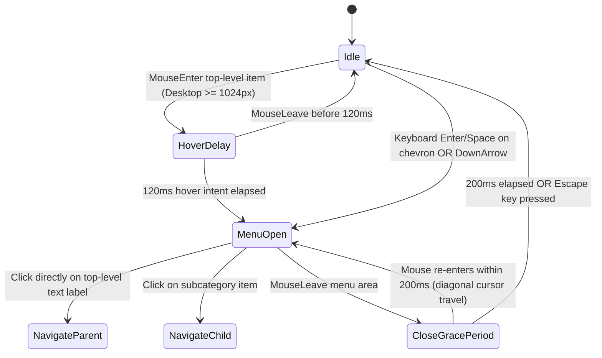

# Deliverable C: Navigation Specification (Excluding Mighty Rewards)

## 1. Header & Navigation Structural Overview

The global header and top navigation system replicates the intuitive multi-department and regional discovery flow of Mighty Depot while **completely excluding the "Mighty Rewards" link and floating loyalty launcher**.

### 1.1 Three-Tier Header Architecture

```
+---------------------------------------------------------------------------------------------------+
| TIER 1: PROMOTIONAL ANNOUNCEMENT BAR (Height: 36px, Configurable Background, Dismissible/Rotating) |
|   "Free Standard Delivery across Israel on orders over ₪250! | Fast Dispatch from Central Hub"    |
+---------------------------------------------------------------------------------------------------+
| TIER 2: UTILITY & SEARCH HEADER (Height: 72px Desktop / 60px Mobile, Sticky on Scroll)            |
|  [Hamburger (Mobile)]  [BRAND LOGO]     [ 🔍 Search products, brands, regions... ]   [👤]  [🛒(3)] |
+---------------------------------------------------------------------------------------------------+
| TIER 3: PRIMARY CATEGORY BAR (Height: 48px Desktop Only; Collapses into Drawer on <1024px)        |
|  Shop by Region ▾ | Sweets ▾ | Snacks ▾ | Pantry ▾ | Drinks ▾ | Canned & Jarred ▾ | Sauce & ... ▾ |
+---------------------------------------------------------------------------------------------------+
```

---

## 2. Complete Top Navigation Hierarchy & Subcategory Mapping

Every top-level category acts both as a **clickable parent collection link** (when clicked directly) and as a **menu trigger** (revealing its subcategories on hover/focus on desktop, or via accordion toggle on mobile).

| Order | Top-Level Label | Parent Route | Menu Layout Type | Child Subcategories (Ordered) |
| :---: | :--- | :--- | :--- | :--- |
| **1** | **Shop by Region** | `/collections/shop-by-region` | **Mega-Menu Grid** (3 Columns + Country Flag Icons) | **East Asia:** China, Japan, South Korea, Taiwan<br>**Southeast Asia:** Thailand, Philippines, Indonesia, Vietnam, Malaysia, Singapore<br>**South Asia & Global:** India, Pakistan, Other Regions |
| **2** | **Sweets** | `/collections/sweets` | **Single-Column Dropdown** (`240px` width) | 1. Chocolates (`/collections/sweets/chocolates`)<br>2. Candy (`/collections/sweets/candy`)<br>3. Cookies (`/collections/sweets/cookies`)<br>4. Jelly (`/collections/sweets/jelly`)<br>5. Cakes (`/collections/sweets/cakes`)<br>6. Mochi (`/collections/sweets/mochi`) |
| **3** | **Snacks** | `/collections/snacks` | **Single-Column Dropdown** (`240px` width) | 1. Chips, Crisps & Puffs (`/collections/snacks/chips-crisps-puffs`)<br>2. Crackers & Buns (`/collections/snacks/crackers-buns`)<br>3. Seafood Snacks (`/collections/snacks/seafood-snacks`)<br>4. Nuts & Seeds (`/collections/snacks/nuts-seeds`) |
| **4** | **Pantry** | `/collections/pantry` | **Two-Column Dropdown** (Includes nested Noodle types) | 1. Rice (`/collections/pantry/rice`)<br>2. Noodles (`/collections/pantry/noodles`)<br>&nbsp;&nbsp;↳ *Japanese Noodles, Korean Noodles, Rice Noodles*<br>3. Flour (`/collections/pantry/flour`)<br>4. Sugar (`/collections/pantry/sugar`) |
| **5** | **Drinks** | `/collections/drinks` | **Single-Column Dropdown** (`240px` width) | 1. Coffee (`/collections/drinks/coffee`)<br>2. Juice (`/collections/drinks/juice`)<br>3. Soy & Milk (`/collections/drinks/soy-milk`)<br>4. Tea (`/collections/drinks/tea`)<br>5. Soda (`/collections/drinks/soda`) |
| **6** | **Canned & Jarred Goods** | `/collections/canned-jarred-goods` | **Single-Column Dropdown** (`260px` width) | 1. Canned & Jarred Meats (`/collections/canned-jarred-goods/meats`)<br>2. Canned & Jarred Vegetables (`/collections/canned-jarred-goods/vegetables`)<br>3. Canned & Jarred Fruits (`/collections/canned-jarred-goods/fruits`) |
| **7** | **Sauce & Seasoning** | `/collections/sauce-seasoning` | **Single-Column Dropdown** (`240px` width) | 1. Soy Sauces (`/collections/sauce-seasoning/soy-sauces`)<br>2. Vinegars (`/collections/sauce-seasoning/vinegars`)<br>3. Ketchups (`/collections/sauce-seasoning/ketchups`)<br>4. Hot Sauces (`/collections/sauce-seasoning/hot-sauces`)<br>5. Dressings (`/collections/sauce-seasoning/dressings`)<br>6. Dipping Sauces (`/collections/sauce-seasoning/dipping-sauces`)<br>7. Spices & Seasonings (`/collections/sauce-seasoning/spices-seasonings`) |
| **8** | **Instant Foods** | `/collections/instant-foods` | **Single-Column Dropdown** (`240px` width) | 1. Instant Noodles & Ramen (`/collections/instant-foods/instant-noodles-ramen`)<br>2. Hot Pot & Meals (`/collections/instant-foods/hot-pot-meals`)<br>3. Soups (`/collections/instant-foods/soups`) |

> [!IMPORTANT]
> **Explicit Exclusion of Mighty Rewards:** Unlike the reference website, no top navigation item, header link, footer link, or floating bottom-corner widget for "Mighty Rewards" (or any points/loyalty program) shall be rendered.

---

## 3. Interactive Behavior Specification (Hover, Click, Touch & Keyboard)



### 3.1 Desktop Navigation (`>= 1024px`)
1. **Hover Intent & Safe Triangle:**
   - **Open Delay (`120ms`):** Hovering over a top-level item triggers the dropdown/mega-menu after a `120ms` debounce to prevent accidental flicker when moving the cursor vertically from the search bar to the page body.
   - **Close Grace Period (`200ms`):** Leaving a menu item starts a `200ms` timer before closing, allowing smooth diagonal mouse movement from the parent trigger into the wider dropdown panel (`Shop by Region`).
   - **Instant Sibling Switch:** Once one dropdown is open, moving horizontally to an adjacent top-level category switches the active dropdown immediately (`0ms` delay) with a `150ms` opacity/transform transition.
2. **Click Behavior on Parent vs. Child:**
   - **Clicking the Top-Level Category Label** (e.g., clicking `"Sweets"`): Navigates immediately to the parent category landing page (`/collections/sweets`), displaying all products across all 6 subcategories (`Chocolates`, `Candy`, `Cookies`, `Jelly`, `Cakes`, `Mochi`).
   - **Clicking a Subcategory Link** (e.g., clicking `"Mochi"`): Navigates directly to `/collections/sweets/mochi`.
3. **Active Route Highlighting:**
   - When the user is viewing `/collections/sweets/mochi`, both the parent `"Sweets"` item in Tier 3 (via a `2px` bottom accent bar) and `"Mochi"` inside its dropdown are visually marked as active (`aria-current="page"`).
4. **Sticky Scroll Behavior:**
   - Scrolling down past `120px` smoothly collapses Tier 1 (Announcement Bar) and pins Tier 2 + Tier 3 to the top of the viewport (`position: sticky; top: 0; z-index: 50`) with a subtle backdrop blur and bottom border shadow.

### 3.2 Mobile & Tablet Navigation (`< 1024px`)
1. **Slide-Out Navigation Drawer:**
   - Tapping the left `☰` Hamburger button (`44x44px` tap target) opens a full-height off-canvas drawer (`width: 85vw`, `max-width: 360px`) sliding from the start edge (`left` in LTR, `right` in Hebrew RTL) over a dimmed backdrop (`rgba(0,0,0,0.5)`).
   - Locking body scroll (`overflow: hidden`) while the drawer is open.
2. **Split-Target Accordion Rows:**
   - Each of the 8 main categories renders as a `52px`-tall row:
     - **Tapping the Category Text OR the row:** Opens the accordion panel beneath it (`aria-expanded="true"`), revealing:
       - Top row inside accordion: **"View All [Category Name]"** (`/collections/[category]`) with item count badge.
       - Followed by all child subcategories.
   - **Single-Open Accordion Mode:** Expanding a new main category automatically collapses the previously expanded category to keep the mobile list scannable without excessive scrolling.
3. **Drawer Footer Utilities:**
   - Pinned at the bottom of the mobile drawer: Customer Account Sign-In / Profile button, Order Tracking quick link, Contact Support (`Support@...`), and Language/Currency switcher (`EN / עברית`).

### 3.3 Keyboard & Screen Reader Accessibility (WCAG 2.2 AA & Israeli Standard IS 5568)
- Full WAI-ARIA Disclosure Navigation Menu pattern (`<nav aria-label="Main Navigation">`).
- Each parent item pairs an `<a>` link with an adjacent keyboard-focusable `<button aria-expanded="false" aria-controls="submenu-sweets">` disclosure chevron so screen-reader and keyboard users can either follow the parent link (`Enter` on link) or toggle the submenu (`Enter`/`Space`/`ArrowDown` on disclosure button).
- Pressing `Escape` inside any open dropdown or search popover closes the overlay and returns focus to the triggering element.

---

## 4. Header Search, Account & Cart Icon Specifications

### 4.1 Predictive Search Interface
- **Placement:** Centered in Tier 2 on desktop (`max-width: 560px`); full-width row immediately below the logo bar on mobile.
- **Trigger & Debounce:** Triggers after `>= 2` characters with a `200ms` debounce against `/api/search/predictive?q={query}`.
- **Predictive Popover Layout:**
  - **Left Column (Desktop) / Top Section (Mobile):**
    - *Suggested Queries / Categories* (up to 4 matching subcategories or regions, e.g., `"Instant Noodles & Ramen"`, `"Region: Japan"`).
  - **Right Column (Desktop) / Main Section (Mobile):**
    - *Top Matching Products* (up to 6 products showing `48x48px` thumbnail, brand/vendor name, product title, stock badge, price/sale price, and a direct `+ Add` mini button).
  - **Bottom Bar:** `"View all {count} results for '{query}' →"` linking to `/search?q={query}`.

### 4.2 Customer Account / Sign-In Access Icon
- **Anonymous State:** Displays User icon + `"Sign In"` label. Clicking opens `/auth/login` (preserving current URL in `?redirect=` parameter so the shopper returns to their exact spot after signing in).
- **Authenticated State:** Displays User avatar/initials + `"Hi, {first_name}"` dropdown menu containing:
  - *My Orders & Tracking* (`/account/orders`)
  - *Saved Addresses* (`/account/addresses`)
  - *Profile & Security* (`/account/profile`)
  - *Admin Dashboard* (`/admin` — rendered **only** if user role is `admin` or `staff`)
  - *Sign Out* (POST `/api/auth/logout`)

### 4.3 Shopping Cart Icon & Slide-Out Basket Drawer Trigger
- **Badge Behavior:** Displays a high-contrast pill badge with total item quantity (`SUM(cart_items.quantity)`). Animates with a subtle scale pulse (`1.0 -> 1.25 -> 1.0` over `250ms`) whenever an item is added.
- **Click Action:** Opens the **Slide-Out Shopping Basket Drawer** from the end edge of the screen without leaving the current page, displaying real-time free-delivery progress (e.g., *"Add ₪42.00 more for FREE Delivery!"*), line items, subtotal, and the primary **"Proceed to Checkout"** CTA.

---

## 5. Footer Structure Specification

The footer is organized into a 4-column desktop grid (stacking into collapsible sections on mobile):
1. **Column 1 — Brand & Contact:** Independent brand logo, short mission statement, warehouse dispatch city, customer support email, operating hours (Sun–Thu 09:00–18:00, Fri 09:00–13:00 IST).
2. **Column 2 — Shop Departments:** Direct links to `Shop by Region`, `Sweets`, `Snacks`, `Pantry`, `Drinks`, `Canned & Jarred Goods`, `Sauce & Seasoning`, `Instant Foods`.
3. **Column 3 — Customer Care & Account:** `My Account`, `Track My Order`, `Shipping & Delivery Policy`, `Returns & Refunds Policy`, `FAQ`, `Contact Us`.
4. **Column 4 — Newsletter & Legal:** Email opt-in form (with explicit GDPR/Israeli Spam Law Section 30A consent checkbox), links to `Privacy Policy`, `Terms & Conditions`, `Accessibility Statement (הצהרת נגישות)`.
5. **Bottom Sub-Footer Bar:** Copyright notice + verified SVG payment badges (`Visa`, `Mastercard`, `American Express`, `Apple Pay`, `Google Pay`, `Bit`, `PayPal`).

