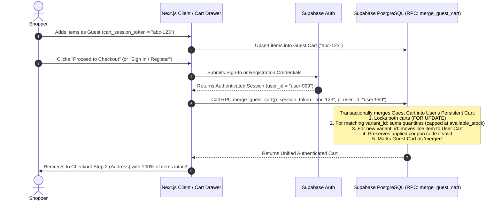

# Deliverable D: E-Commerce Functional Specification

## 1. Product Catalogue & Product Detail Pages (PDP)

### 1.1 Product Listing Layouts (Collection & Category Pages)
- **Responsive Grid Density:**
  - Desktop (`>= 1280px`): 4 or 5 cards per row (`gap: 20px`).
  - Small Desktop / Tablet Landscape (`1024px–1279px`): 3 cards per row.
  - Tablet Portrait / Mobile (`< 1024px`): 2 cards per row (`gap: 12px`).
- **Product Card Anatomy:**
  1. **Top Badges Overlay:**
     - Top-Start: `Sale -X%` (Crimson badge when `compare_at_price > price`), `New` (within 30 days), or `Out of Stock` (Muted Charcoal).
     - Top-End: Country of Origin Flag Pill (e.g., `🇯🇵 Japan`, `🇰🇷 Korea`, `🇹🇭 Thailand`).
  2. **Image Container:** `1:1` square aspect ratio, `webp`/`avif` next-gen format, lazy-loaded below the fold, secondary hover image reveal on desktop.
  3. **Vendor / Brand Subtitle:** Uppercase muted link (`12px`, e.g., `ORION`, `KAGAYAKI`, `MAE PLOY`).
  4. **Product Title:** 2-line clamped (`line-clamp: 2`, `min-height: 2.75rem`) linking to `/products/[slug]`, including package weight/volume (e.g., *HAIO Korean Honey Citron Tea — 1kg*).
  5. **Rating Summary:** Star rating (`★★★★★ 4.8 (42)`) — hidden cleanly if `review_count = 0`.
  6. **Price Block:**
     - Current Price in `₪ ILS` (e.g., `₪24.90`), formatted with `incl. VAT` (`כולל מע"מ`).
     - Compare-at Price struck through (`₪32.00`) when on sale.
     - Unit price per `100g` or `100ml` (`₪2.49 / 100g`) to comply with **Israeli Consumer Protection (Price Display) Regulations**.
  7. **Action Control:**
     - Single-variant in-stock product: Direct **`Add to Basket`** button; once in basket, transforms into an inline **`[ - ]  2 in basket  [ + ]`** stepper.
     - Multi-variant product: **`Choose Options`** button opening a quick-view modal or navigating to PDP.
     - Out-of-stock product: **`Notify Me When Available`** button.

### 1.2 Faceted Filtering & Sorting Specification
- **Sidebar / Drawer Filters (Multi-Select with Live Facet Counts):**
  1. **Subcategory** (within current department).
  2. **Country / Region of Origin** (China, Japan, South Korea, Taiwan, Thailand, Philippines, India, Indonesia, Vietnam, Malaysia, Singapore, Pakistan, Other).
  3. **Availability** (`In Stock Only` toggle, `On Sale`).
  4. **Price Range** (Dual-thumb slider + `Min ₪` / `Max ₪` inputs).
  5. **Brand / Vendor** (Searchable checkbox list).
  6. **Dietary & Certification Tags** (`Kosher / כשר`, `Vegan`, `Vegetarian`, `Gluten-Free`, `Halal`, `No MSG`).
  7. **Spice Level** (`Mild`, `Medium`, `Spicy`, `Extra Hot`).
- **Sorting Options (`?sort=`):**
  - `featured` (Default curated rank)
  - `best-selling` (By 30-day order volume)
  - `price-asc` (Price: Low to High)
  - `price-desc` (Price: High to Low)
  - `newest` (Date: New to Old)
  - `rating-desc` (Highest Customer Rating)
  - `title-asc` / `title-desc` (Alphabetical A–Z / Z–A)

### 1.3 Product Detail Page (PDP) Specification
- **Left Column — Interactive Media Gallery:**
  - Main high-res `1:1` image (`1200x1200px` source) with hover magnifier on desktop and pinch-to-zoom lightbox on mobile.
  - Thumbnail strip (front package, back nutrition/ingredients label in Hebrew/English, texture/serving photo).
- **Right Column — Purchase & Variant Box:**
  - Breadcrumb trail: `Home > Sauce & Seasoning > Dipping Sauces > Mae Ploy Sweet Chili Sauce`.
  - Brand link, Country of Origin badge, and SKU code.
  - Product Title (`<h1>`) and net weight/volume.
  - Verified Star Rating anchor link scrolling to reviews section.
  - Price, Compare-At Sale Price, `% Saved` pill, and Unit Price (`per 100g/100ml`).
  - **Variant Selector:** Pill buttons for Size / Pack Quantity (e.g., `Single (1 Pack)`, `Bundle of 3 (Save 8%)`, `Case of 12 (Save 15%)`) or Flavor. Selecting a variant dynamically updates the image, SKU, price, and stock indicator without a page reload.
  - **Stock Availability Indicator:**
    - `> 10 units`: Green badge `"In Stock — Ready for Fast Dispatch"`.
    - `1–10 units`: Amber urgency badge `"Low Stock — Only {n} left!"`.
    - `0 units`: Gray badge `"Out of Stock"` + back-in-stock email alert signup.
  - **Quantity Stepper & Add-to-Basket CTA:** Quantity input (`1` to `min(available_stock, max_per_order)`), primary **`Add to Basket`** button.
- **Below the Fold — Structured Product Information Tabs:**
  1. **Description & Culinary Uses:** Rich text product overview and serving suggestions.
  2. **Ingredients, Allergens & Nutrition Facts:** Mandatory nutritional table per `100g/100ml` (Calories, Proteins, Carbohydrates, Sugars, Fats, Saturated Fats, Trans Fats, Cholesterol, Sodium — including Israeli Ministry of Health red-label indicators where applicable for high sodium/sugar/saturated fat) and bolded **Allergen Warnings** (Soy, Wheat/Gluten, Peanuts, Tree Nuts, Sesame, Shellfish, Fish, Dairy, Eggs).
  3. **Storage & Shelf Life:** Storage instructions (e.g., *"Store in a cool, dry place; refrigerate after opening"*), minimum guaranteed shelf-life upon delivery.
- **Recommendations & Reviews:**
  - **Frequently Bought Together / Related Products:** 4-card carousel pulled from the same subcategory or culinary region (e.g., pairing *Sushi Rice* with *Roasted Nori* and *Rice Vinegar*).
  - **Verified Customer Reviews:** Star distribution histogram (5★ down to 1★), verified buyer badge (`Verified Purchase`), photo review upload, and helpfulness voting.

---

## 2. Persistent & Synchronized Shopping Basket System

### 2.1 Core Basket Functional Requirements
1. **Unrestricted Guest Basket Building:** Anonymous visitors can add, remove, and update quantities in their basket across any number of pages or sessions without being forced to log in prematurely.
2. **Dual-Layer Persistence (Local + Server Guest Cart):**
   - When an anonymous visitor adds their first item, the backend issues an HTTP-only signed cookie (`cart_session_token`, 30-day TTL, mirrored in `localStorage` fallback) linked to a row in the `carts` table (`user_id = NULL`, `session_token = UUID`).
   - If the customer closes the browser and returns days later on the same device, their full basket is immediately restored from Supabase via `cart_session_token`.
3. **Real-Time Basket Calculations:**
   - **Line Subtotal:** `quantity * effective_unit_price`.
   - **Basket Subtotal:** `SUM(line_subtotals)`.
   - **Automatic & Coupon Discounts:** Validates promo code rules (minimum spend, eligible categories, expiry, single-use per customer) and displays the discount deduction line.
   - **Free-Delivery Progress Bar:** Dynamically computes `MAX(0, free_shipping_threshold - discounted_subtotal)` and renders a visual progress bar inside the basket drawer.
   - **Estimated Delivery Cost & Final Order Total:** Displays estimated delivery fee based on selected/default zone (or `FREE` once threshold is met) and the final total (`Subtotal - Discounts + Delivery`).

### 2.2 Deterministic Guest-to-Account Basket Synchronization (Critical Requirement)

- **Conflict Resolution Rules during Cart Merge:**
  - **Scenario A (User had no prior saved account cart):** The guest cart row is directly assigned `user_id = authenticated_user_id` and `session_token = NULL`.
  - **Scenario B (User had a previously saved cart from another device AND a current guest cart):** Both carts are merged inside a single ACID PostgreSQL transaction (`merge_guest_cart`). If SKU `X` exists in both carts (e.g., `2` in saved account cart + `1` in guest cart), the merged quantity becomes `MIN(2 + 1, current_available_stock)`. If capped by stock, a non-intrusive toast notifies the user that the quantity was adjusted to maximum available stock.

---

## 3. Customer Registration, Authentication & Account Portal

### 3.1 Authentication Lifecycle
1. **New Customer Registration (`/auth/register`):**
   - Fields: Full Name, Email Address, Mobile Phone (for courier SMS updates), Password (validated against NIST SP 800-63B rules: minimum 10 characters, breached-password check), and optional Marketing Consent checkbox.
   - Preserves `?redirect=/checkout/address` query parameter and `cart_session_token` cookie across the entire registration and email verification flow.
2. **Email Verification:**
   - Sends a cryptographic 6-digit OTP **and** magic link to the customer's email. Entering the 6-digit OTP inline on the checkout screen verifies the email immediately in the same tab so checkout flow momentum is never broken.
3. **Sign-In & Sign-Out (`/auth/login`):**
   - Email + Password authentication, immediately invoking `merge_guest_cart` upon success.
   - Sign-out clears the active JWT session while leaving saved server-side account cart items untouched in the database for the next sign-in.
4. **Password Reset:**
   - Rate-limited `/auth/forgot-password` endpoint issuing a single-use, 15-minute expiring token; invalidates existing sessions upon password change.

### 3.2 Customer Account Portal (`/account/*`)
- **Profile Management:** Edit name, email (with re-verification), phone number, preferred language, and password.
- **Saved Delivery Addresses:** Store multiple named addresses (*"Home"*, *"Office"*, *"Parents"*), including City, Street, House Number, Apartment, Floor, Entrance Code (`קוד כניסה לבניין`), and Courier Delivery Notes (e.g., *"Leave by the door"*).
- **Order History & Live Order Tracking:**
  - View all past orders with status badges (`Pending Payment`, `Confirmed`, `Picking & Packing`, `Dispatched with Courier`, `Out for Delivery`, `Delivered`, `Cancelled / Refunded`).
  - Download official Israeli Tax Invoice / Receipt (`חשבונית מס / קבלה`) PDF.
  - One-click **"Reorder All Items"** button that adds a past order's items back into the current basket.
  - Visual 5-stage tracking timeline with live courier tracking number and link.

---

## 4. Secure 9-Step Checkout Process Specification

Customers can browse and build their basket anonymously, but **must authenticate at Step 1** before completing a purchase. The UI groups the 9 logical steps into a clean, distraction-free progressive checkout wizard:

| Step # | Checkout Step Name | Customer Experience & Validation | Backend Process & Integration |
| :---: | :--- | :--- | :--- |
| **Step 1** | **Customer Sign-In or Registration** | If already signed in, automatically marked complete (shows `"Signed in as {email}"`) and advances to Step 2. If guest, displays inline Sign-In / Quick Register tabs right inside the checkout shell. | Authenticates via Supabase Auth; executes `merge_guest_cart` RPC; verifies stock availability of all merged items. |
| **Step 2** | **Delivery Address** | Customer selects a saved address card (1 click) or fills out the new address form with Israeli City/Street autocomplete, apartment, floor, building code, and mobile phone for SMS delivery alerts. | Validates address against `shipping_zones` postal/city database; checks for any geographic delivery restrictions; optionally saves new address to `customer_addresses`. |
| **Step 3** | **Delivery Method Selection** | Presents eligible delivery methods for the customer's zone: **Standard Home Delivery** (2–4 business days), **Express Next-Day Delivery** (Gush Dan/Center), or **Locker / Pickup Point (`נקודת איסוף`)**. | Filters active `shipping_methods` by destination zone, total parcel weight (`SUM(item_weight * qty)`), and chilled/ambient constraints. |
| **Step 4** | **Delivery Cost Calculation** | Displays exact shipping charge for the chosen method or crosses it out (`₪35.00 -> FREE`) if the basket meets the configurable free-shipping threshold (e.g., `>= ₪250`). | Server-side calculation engine (`calculate_checkout_totals`) computes exact delivery fee; client values are never trusted. |
| **Step 5** | **Order Summary Review** | Displays itemized basket (thumbnails, titles, quantities, unit prices), subtotal, discount breakdown, VAT (`18% מע"מ` included breakdown), delivery fee, and final payable amount in `₪ ILS`. | Creates or updates a draft `checkout_session` and places a temporary 15-minute soft stock reservation (`inventory_reservations`) to prevent overselling during payment. |
| **Step 6** | **Payment Method Selection** | Customer selects preferred payment method: **Credit / Debit Card** (Visa, Mastercard, Amex, Diners, Isracard), **Apple Pay / Google Pay**, **Bit** (Israeli instant payment app), or **PayPal**. Supports configurable installment selection (`תשלומים`) if order exceeds threshold. | Initializes a payment intent with the selected gateway using a unique `idempotency_key = checkout_session_id + attempt_number`. |
| **Step 7** | **Payment Processing** | Customer completes payment inside a PCI-DSS compliant hosted iframe / tokenized payment element (3D Secure 2.0 / EMV challenge). | Gateway processes authorization & capture; sends signed webhook (`HMAC-SHA256`) to `/api/webhooks/payments`. Backend verifies signature, prevents duplicate capture, converts soft stock reservation into permanent inventory deduction, and transitions order to `paid`. |
| **Step 8** | **Order Confirmation Page** | Redirects to `/checkout/confirmation/[order_number]` displaying order number, payment reference, itemized receipt, estimated delivery window, and tracking link. | Clears the active customer shopping basket (`carts`) and triggers asynchronous post-purchase workers. |
| **Step 9** | **Confirmation Email & Tax Invoice** | Customer receives an immediate transactional confirmation email (via Resend / AWS SES) with full order details and an attached official Israeli Tax Invoice (`חשבונית מס קבלה`). | Webhook worker generates legal tax invoice via Israeli invoicing API (Morning / GreenInvoice or Cardcom/PayPlus invoicing) and dispatches email + optional SMS confirmation. |

---

## 5. Delivery & Shipping System (Adapted for Israel)

Rather than copying Mighty Depot's US/Canada Queens-origin shipping rules, the platform implements a **configurable Israel-focused delivery engine**:

### 5.1 Configurable Delivery Zones & Default Rate Matrix (Admin-Editable)
| Zone ID | Zone Name (Israel) | Representative Cities / Regions | Standard Delivery (Home Courier) | Express Delivery (Same / Next Day) | Pickup Point / Locker (`Boxit / Cheetah`) | Free Standard Delivery Threshold |
| :--- | :--- | :--- | :--- | :--- | :--- | :--- |
| **IL-Z1** | **Gush Dan & Center** | Tel Aviv, Ramat Gan, Givatayim, Holon, Bat Yam, Petah Tikva, Rishon LeZion, Bnei Brak | `₪29` (1–3 bus. days) | `₪49` (Next day / Same day cutoff 11:00) | `₪19` | Orders `>= ₪250` |
| **IL-Z2** | **Sharon & Shfela** | Herzliya, Ra'anana, Kfar Saba, Netanya, Rehovot, Ness Ziona, Modi'in, Ashdod | `₪32` (2–3 bus. days) | `₪55` (Next business day) | `₪19` | Orders `>= ₪250` |
| **IL-Z3** | **Jerusalem, Haifa & North** | Jerusalem, Beit Shemesh, Haifa, Krayot, Acre, Nahariya, Nazareth, Tiberias, Afula | `₪35` (2–4 bus. days) | Not Available (or `₪69` select cities) | `₪22` | Orders `>= ₪280` |
| **IL-Z4** | **South & Negev** | Ashkelon, Be'er Sheva, Kiryat Gat, Sderot, Netivot, Ofakim | `₪35` (2–4 bus. days) | Not Available | `₪22` | Orders `>= ₪280` |
| **IL-Z5** | **Remote / Eilat, Arava, Golan & Dead Sea** | Eilat, Mitzpe Ramon, Arava settlements, Golan Heights (Size/Weight & Heat Restrictions apply) | `₪49` (3–6 bus. days) | Restricted | `₪29` | Orders `>= ₪350` |

### 5.2 Special Grocery Shipping Controls
- **Weight & Bulk Surcharges:** Orders containing multiple bulk `15 lb / 6.8 kg` rice bags or glass beverage crates exceeding `20 kg` automatically compute a configurable heavy-parcel surcharge (e.g., `+₪15` per additional `15 kg` bracket).
- **Summer Heat / Melt-Sensitive Protection:** Products tagged `heat_sensitive = true` (e.g., imported Chocolates, Mochi in summer months) automatically flag the warehouse packing slip for insulated thermal pouch + gel ice pack, or restrict locker pickup in `IL-Z5` during July–August.
- **Automated Dispatch & Tracking Notifications:**
  - Integrations with major Israeli logistics providers (**HFD**, **Cheetah Delivery**, **YDM**, **Israel PostShlihim**, and **Wolt Drive** for Gush Dan Express).
  - Status webhooks trigger automatic email and SMS notifications at: `Order Confirmed` -> `Packed & Dispatched (with tracking link)` -> `Courier Out for Delivery Today` -> `Delivered`.

---

## 6. Payment Facilities & Gateway Architecture (Israel + International)

### 6.1 Supported Payment Methods
1. **Credit & Debit Cards:** Visa, Mastercard, American Express, Diners Club, and **Isracard** (domestic & international cards).
2. **Digital Wallets:** **Apple Pay** and **Google Pay** (via native browser Payment Request API / gateway tokenization).
3. **Israeli Local Instant Payment:** **Bit (`ביט`)** and **PayBox** (essential for high conversion in the Israeli e-commerce market, where Bit accounts for ~20–30% of B2C checkouts).
4. **PayPal:** Express and standard PayPal checkout.
5. **Installments (`תשלומים` / Tashlumim):** Admin-configurable installment tiers (e.g., 1 payment up to `₪299`; up to 3 interest-free payments for orders `₪300+`).

### 6.2 Recommended Payment Gateway Architecture for Israel
Because standard Stripe accounts have historically had limited native support for Israeli local clearing (`Shva` / `שב"א`), `Isracard`, `Bit`, and automated Israeli Tax Authority invoices (`חשבונית מס קבלה`), we recommend a **Primary Israeli Gateway + Secondary PayPal/Global Gateway** architecture:

| Gateway Role | Recommended Provider | Why Recommended for Israel | Supported Methods |
| :--- | :--- | :--- | :--- |
| **Primary Gateway (Recommended)** | **PayPlus (`פייפלוס`)** or **Meshulam / Grow** (Alternative: **Tranzila** or **Cardcom**) | • Direct clearing with Israeli credit companies (Isracard, Cal, Max) via Shva (`שב"א`). • Native **Bit**, **Apple Pay**, and **Google Pay** support in a single hosted/iframe integration. • Built-in 3D Secure 2.0 (`EMV`) fraud liability shift. • Automatic generation of legally signed **Israeli Tax Invoices (`חשבונית מס קבלה`)** upon capture. | Visa, Mastercard, Amex, Diners, Isracard, Bit, Apple Pay, Google Pay, Tashlumim (Installments). |
| **Secondary Wallet** | **PayPal Commerce Platform** | Trusted by international expats and shoppers preferring PayPal Buyer Protection. | PayPal Balance, Linked Cards. |

### 6.3 Payment Security & Reliability Engineering
- **Zero Card Data on Server:** Payment inputs render inside a PCI-DSS Level 1 hosted iframe/payment element (`PayPlus Hosted Fields` / `Tranzila Direct Iframe`). Raw PAN (card numbers) and CVV codes **never touch our application servers or database**.
- **Idempotency & Duplicate-Charge Prevention:** Every payment initiation generates a deterministic `idempotency_key` stored in `payment_transactions`. Retrying a network timeout checks the gateway status for that key before creating a new charge.
- **Declined Transaction Handling:** Maps gateway decline codes (e.g., *Insufficient Funds*, *3DS Authentication Failed*, *Expired Card*) into user-friendly localized messages while keeping the customer's checkout step, address, and stock reservation intact so they can immediately retry or switch to Bit/PayPal.
- **Automated Refunds:** Admins can execute full or partial refunds directly from `/admin/orders/[id]`, which calls the gateway Refund API, logs the `refund_transaction_reference`, and automatically issues a Credit Tax Invoice (`חשבונית זיכוי`).

---

## 7. Administration Dashboard Specification (15 Core Capabilities)

The `/admin` portal provides authorized personnel with complete operational control:

1. **Product Management:** Full CRUD for products, rich-text descriptions, country of origin, dietary/allergen flags, nutritional facts per 100g, and SEO meta titles/descriptions.
2. **Category & Subcategory Management:** Drag-and-drop ordering of main categories and subcategories, custom collection banners, and visibility toggles.
3. **Product Image Management:** Multi-image drag-and-drop upload to Supabase Storage with automatic WebP optimization, alt-text editor, and primary thumbnail selection.
4. **Pricing & Discounts Engine:** Manage regular price, `compare_at_price` (sale price), unit price calculation (`per 100g/100ml`), promotional coupon codes (`% off`, `fixed ₪ off`, `free shipping`), and scheduled flash sales.
5. **Inventory & Batch Management:** Real-time stock levels per variant, reserved stock visibility, low-stock threshold alerts, batch expiration date tracking (FIFO warnings for perishable/dated imports), and CSV bulk stock import/export.
6. **Order Processing & Fulfillment:** Filterable order queue (`Unfulfilled`, `Picking`, `Packed`, `Dispatched`), printable bilingual packing slips (`תעודת משלוח`), and one-click courier label generation.
7. **Delivery Status Updates:** Manual or webhook-driven status updates that automatically notify the customer via email/SMS with tracking links.
8. **Customer Management:** Searchable customer directory showing lifetime value (LTV), order count, saved addresses, account lock/unlock controls, and GDPR/PPL data export/anonymization tools.
9. **Refund & RMA Processing:** Review customer return requests, inspect uploaded damage photos, issue partial/full gateway refunds + Credit Invoices (`חשבונית זיכוי`), and choose whether to restock items.
10. **Payment Settings Configuration:** Toggle active payment methods (Credit Cards, Bit, Apple Pay, Google Pay, PayPal), configure installment (`Tashlumim`) rules, and view webhook health logs.
11. **Shipping & Delivery Rate Configuration:** Edit delivery zones, city/postal mappings, standard/express prices, weight surcharges, and the global or zone-specific Free Delivery threshold (e.g., `₪250`).
12. **Promotional Banner Management:** Create, schedule (start/end dates), and preview top announcement bars and homepage hero carousel banners without writing code.
13. **Website Content Management (CMS):** WYSIWYG/Markdown editor for `About Us`, `FAQ`, `Shipping Policy`, `Refund Policy`, `Privacy Policy`, `Terms`, and `Accessibility Statement`.
14. **Sales & Operational Reports:** Interactive charts for Daily/Monthly Gross & Net Revenue, Average Order Value (AOV), Top Selling Products, Sales by Region of Origin (e.g., Japan vs. Korea vs. Thailand), and Abandoned Checkout conversion rates.
15. **Administrator Permissions & RBAC:** Assign granular roles (`Super Admin`, `Catalog Manager`, `Warehouse Fulfillment`, `Customer Support`), enforce mandatory TOTP 2FA for all staff accounts, and review the immutable `admin_audit_logs` table.

