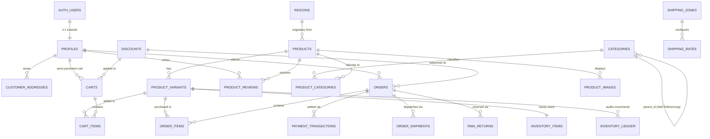

# Deliverable F: Database Specification (Supabase PostgreSQL)

## 1. Entity-Relationship Architecture

The database is engineered for **Supabase (PostgreSQL 15+)**, supporting hierarchical categories, cross-cutting regional collections (`Shop by Region`), multi-variant products, real-time batch/stock tracking, persistent guest and authenticated carts with atomic login merging, multi-zone Israeli shipping rules, tokenized payment records, and strict Row-Level Security (RLS).



---

## 2. Complete PostgreSQL Schema DDL (`Supabase Migration`)

```sql
-- Enable required PostgreSQL extensions
CREATE EXTENSION IF NOT EXISTS "pgcrypto";
CREATE EXTENSION IF NOT EXISTS "pg_trgm";

-- ============================================================================
-- 1. ENUMS & CUSTOM TYPES
-- ============================================================================
CREATE TYPE user_role AS ENUM ('customer', 'support_agent', 'fulfillment_staff', 'catalog_manager', 'super_admin');
CREATE TYPE cart_status AS ENUM ('active', 'merged', 'converted', 'abandoned');
CREATE TYPE order_status AS ENUM (
    'pending_payment', 'paid', 'processing', 'picking', 'packed',
    'dispatched', 'out_for_delivery', 'delivered', 'cancelled', 'refunded'
);
CREATE TYPE payment_status AS ENUM ('pending', 'authorized', 'captured', 'declined', 'refunded', 'partially_refunded');
CREATE TYPE discount_type AS ENUM ('percentage', 'fixed_amount', 'free_shipping');

-- ============================================================================
-- 2. CUSTOMER PROFILES, ROLES & SAVED ADDRESSES
-- ============================================================================
CREATE TABLE public.profiles (
    id UUID PRIMARY KEY REFERENCES auth.users(id) ON DELETE CASCADE,
    email TEXT UNIQUE NOT NULL,
    full_name TEXT NOT NULL,
    phone TEXT,
    role user_role NOT NULL DEFAULT 'customer',
    preferred_locale TEXT NOT NULL DEFAULT 'he-IL',
    marketing_opt_in BOOLEAN NOT NULL DEFAULT FALSE,
    marketing_opt_in_at TIMESTAMPTZ,
    is_suspended BOOLEAN NOT NULL DEFAULT FALSE,
    created_at TIMESTAMPTZ NOT NULL DEFAULT NOW(),
    updated_at TIMESTAMPTZ NOT NULL DEFAULT NOW()
);

CREATE TABLE public.customer_addresses (
    id UUID PRIMARY KEY DEFAULT gen_random_uuid(),
    user_id UUID NOT NULL REFERENCES public.profiles(id) ON DELETE CASCADE,
    label TEXT NOT NULL DEFAULT 'Home', -- e.g., 'Home', 'Office'
    recipient_name TEXT NOT NULL,
    phone TEXT NOT NULL,
    city TEXT NOT NULL,
    street_name TEXT NOT NULL,
    house_number TEXT NOT NULL,
    apartment TEXT,
    floor TEXT,
    entrance_code TEXT, -- Building intercom/keypad code
    postal_code TEXT,
    shipping_zone_id UUID, -- Resolved Israeli delivery zone
    delivery_instructions TEXT,
    is_default_shipping BOOLEAN NOT NULL DEFAULT FALSE,
    is_default_billing BOOLEAN NOT NULL DEFAULT FALSE,
    created_at TIMESTAMPTZ NOT NULL DEFAULT NOW(),
    updated_at TIMESTAMPTZ NOT NULL DEFAULT NOW()
);

-- ============================================================================
-- 3. CATEGORIES, SUBCATEGORIES & REGIONS (SHOP BY REGION)
-- ============================================================================
CREATE TABLE public.categories (
    id UUID PRIMARY KEY DEFAULT gen_random_uuid(),
    parent_id UUID REFERENCES public.categories(id) ON DELETE RESTRICT,
    name_en TEXT NOT NULL,
    name_he TEXT,
    slug TEXT UNIQUE NOT NULL, -- e.g., 'sweets', 'sweets/mochi'
    description_en TEXT,
    description_he TEXT,
    banner_image_url TEXT,
    display_order INTEGER NOT NULL DEFAULT 0,
    is_active BOOLEAN NOT NULL DEFAULT TRUE,
    seo_title TEXT,
    seo_description TEXT,
    created_at TIMESTAMPTZ NOT NULL DEFAULT NOW(),
    updated_at TIMESTAMPTZ NOT NULL DEFAULT NOW()
);

CREATE TABLE public.regions (
    id UUID PRIMARY KEY DEFAULT gen_random_uuid(),
    name_en TEXT NOT NULL, -- e.g., 'Japan', 'Republic of Korea', 'Thailand'
    name_he TEXT,
    slug TEXT UNIQUE NOT NULL, -- e.g., 'region-japan'
    iso_country_code CHAR(2), -- e.g., 'JP', 'KR', 'TH', 'CN', 'TW', 'PH', 'IN', 'ID', 'VN', 'MY', 'SG', 'PK'
    flag_emoji TEXT,
    banner_image_url TEXT,
    display_order INTEGER NOT NULL DEFAULT 0,
    is_active BOOLEAN NOT NULL DEFAULT TRUE,
    created_at TIMESTAMPTZ NOT NULL DEFAULT NOW()
);

-- ============================================================================
-- 4. PRODUCTS, VARIANTS, IMAGES & INVENTORY LEDGER
-- ============================================================================
CREATE TABLE public.products (
    id UUID PRIMARY KEY DEFAULT gen_random_uuid(),
    title_en TEXT NOT NULL,
    title_he TEXT,
    slug TEXT UNIQUE NOT NULL,
    vendor_brand TEXT NOT NULL, -- e.g., 'Orion', 'Kagayaki', 'Mae Ploy', 'HAIO'
    region_id UUID REFERENCES public.regions(id) ON DELETE SET NULL,
    short_description_en TEXT,
    description_html_en TEXT,
    description_html_he TEXT,
    ingredients_text TEXT,
    allergens TEXT[] DEFAULT '{}', -- e.g., ARRAY['Soy', 'Wheat', 'Sesame']
    dietary_tags TEXT[] DEFAULT '{}', -- e.g., ARRAY['Kosher', 'Vegan', 'Gluten-Free']
    nutrition_facts_jsonb JSONB DEFAULT '{}'::jsonb, -- Per 100g/100ml + Israeli red-label flags
    storage_instructions TEXT,
    is_heat_sensitive BOOLEAN NOT NULL DEFAULT FALSE,
    is_fragile BOOLEAN NOT NULL DEFAULT FALSE,
    is_active BOOLEAN NOT NULL DEFAULT TRUE,
    is_featured BOOLEAN NOT NULL DEFAULT FALSE,
    rating_average NUMERIC(3,2) NOT NULL DEFAULT 0.00,
    rating_count INTEGER NOT NULL DEFAULT 0,
    seo_title TEXT,
    seo_description TEXT,
    created_at TIMESTAMPTZ NOT NULL DEFAULT NOW(),
    updated_at TIMESTAMPTZ NOT NULL DEFAULT NOW()
);

CREATE TABLE public.product_categories (
    product_id UUID NOT NULL REFERENCES public.products(id) ON DELETE CASCADE,
    category_id UUID NOT NULL REFERENCES public.categories(id) ON DELETE CASCADE,
    PRIMARY KEY (product_id, category_id)
);

CREATE TABLE public.product_variants (
    id UUID PRIMARY KEY DEFAULT gen_random_uuid(),
    product_id UUID NOT NULL REFERENCES public.products(id) ON DELETE CASCADE,
    sku TEXT UNIQUE NOT NULL,
    barcode_ean TEXT,
    title TEXT NOT NULL DEFAULT 'Default', -- e.g., 'Single Pack (120g)', 'Pack of 3'
    option1_name TEXT, -- e.g., 'Size'
    option1_value TEXT, -- e.g., '1 kg'
    option2_name TEXT, -- e.g., 'Flavor'
    option2_value TEXT,
    price_ils NUMERIC(10,2) NOT NULL CHECK (price_ils >= 0),
    compare_at_price_ils NUMERIC(10,2) CHECK (compare_at_price_ils IS NULL OR compare_at_price_ils >= price_ils),
    cost_price_ils NUMERIC(10,2) CHECK (cost_price_ils IS NULL OR cost_price_ils >= 0),
    vat_rate_percent NUMERIC(5,2) NOT NULL DEFAULT 18.00,
    net_weight_grams INTEGER NOT NULL CHECK (net_weight_grams > 0),
    shipping_weight_grams INTEGER NOT NULL CHECK (shipping_weight_grams > 0),
    unit_measure_type TEXT DEFAULT '100g', -- For statutory price per 100g/100ml calculation
    max_per_order INTEGER NOT NULL DEFAULT 24,
    display_order INTEGER NOT NULL DEFAULT 0,
    is_active BOOLEAN NOT NULL DEFAULT TRUE,
    created_at TIMESTAMPTZ NOT NULL DEFAULT NOW(),
    updated_at TIMESTAMPTZ NOT NULL DEFAULT NOW()
);

CREATE TABLE public.product_images (
    id UUID PRIMARY KEY DEFAULT gen_random_uuid(),
    product_id UUID NOT NULL REFERENCES public.products(id) ON DELETE CASCADE,
    variant_id UUID REFERENCES public.product_variants(id) ON DELETE SET NULL,
    storage_path TEXT NOT NULL,
    public_url TEXT NOT NULL,
    alt_text TEXT NOT NULL,
    display_order INTEGER NOT NULL DEFAULT 0,
    is_primary BOOLEAN NOT NULL DEFAULT FALSE,
    created_at TIMESTAMPTZ NOT NULL DEFAULT NOW()
);

CREATE TABLE public.inventory_items (
    variant_id UUID PRIMARY KEY REFERENCES public.product_variants(id) ON DELETE CASCADE,
    on_hand_quantity INTEGER NOT NULL DEFAULT 0 CHECK (on_hand_quantity >= 0),
    reserved_quantity INTEGER NOT NULL DEFAULT 0 CHECK (reserved_quantity >= 0),
    available_quantity INTEGER GENERATED ALWAYS AS (GREATEST(0, on_hand_quantity - reserved_quantity)) STORED,
    low_stock_threshold INTEGER NOT NULL DEFAULT 10,
    nearest_expiry_date DATE,
    warehouse_bin_location TEXT,
    updated_at TIMESTAMPTZ NOT NULL DEFAULT NOW()
);

CREATE TABLE public.inventory_ledger (
    id UUID PRIMARY KEY DEFAULT gen_random_uuid(),
    variant_id UUID NOT NULL REFERENCES public.product_variants(id) ON DELETE RESTRICT,
    change_amount INTEGER NOT NULL,
    reason TEXT NOT NULL, -- 'purchase_capture', 'restock', 'rma_return', 'manual_adjustment', 'spoilage'
    reference_order_id UUID,
    actor_user_id UUID REFERENCES public.profiles(id),
    created_at TIMESTAMPTZ NOT NULL DEFAULT NOW()
);

-- ============================================================================
-- 5. DISCOUNTS & PROMOTIONS
-- ============================================================================
CREATE TABLE public.discounts (
    id UUID PRIMARY KEY DEFAULT gen_random_uuid(),
    code TEXT UNIQUE NOT NULL, -- e.g., 'WELCOME10'
    description TEXT,
    discount_type discount_type NOT NULL,
    discount_value NUMERIC(10,2) NOT NULL CHECK (discount_value >= 0),
    min_order_subtotal_ils NUMERIC(10,2) NOT NULL DEFAULT 0.00,
    max_discount_amount_ils NUMERIC(10,2),
    usage_limit_total INTEGER,
    usage_limit_per_user INTEGER DEFAULT 1,
    times_used INTEGER NOT NULL DEFAULT 0,
    starts_at TIMESTAMPTZ NOT NULL DEFAULT NOW(),
    expires_at TIMESTAMPTZ,
    is_active BOOLEAN NOT NULL DEFAULT TRUE,
    created_at TIMESTAMPTZ NOT NULL DEFAULT NOW()
);

-- ============================================================================
-- 6. PERSISTENT & SYNCHRONIZED SHOPPING BASKETS (CARTS)
-- ============================================================================
CREATE TABLE public.carts (
    id UUID PRIMARY KEY DEFAULT gen_random_uuid(),
    user_id UUID REFERENCES public.profiles(id) ON DELETE CASCADE, -- NULL for anonymous guest cart
    session_token UUID UNIQUE, -- Signed cookie token for anonymous guest persistence
    status cart_status NOT NULL DEFAULT 'active',
    applied_discount_id UUID REFERENCES public.discounts(id) ON DELETE SET NULL,
    notes TEXT,
    created_at TIMESTAMPTZ NOT NULL DEFAULT NOW(),
    updated_at TIMESTAMPTZ NOT NULL DEFAULT NOW(),
    CONSTRAINT uq_one_active_cart_per_user UNIQUE NULLS NOT DISTINCT (user_id, status)
);

CREATE TABLE public.cart_items (
    id UUID PRIMARY KEY DEFAULT gen_random_uuid(),
    cart_id UUID NOT NULL REFERENCES public.carts(id) ON DELETE CASCADE,
    variant_id UUID NOT NULL REFERENCES public.product_variants(id) ON DELETE CASCADE,
    quantity INTEGER NOT NULL CHECK (quantity > 0 AND quantity <= 99),
    added_at TIMESTAMPTZ NOT NULL DEFAULT NOW(),
    updated_at TIMESTAMPTZ NOT NULL DEFAULT NOW(),
    UNIQUE (cart_id, variant_id)
);

-- ============================================================================
-- 7. SHIPPING ZONES & CONFIGURABLE DELIVERY RATES
-- ============================================================================
CREATE TABLE public.shipping_zones (
    id UUID PRIMARY KEY DEFAULT gen_random_uuid(),
    zone_code TEXT UNIQUE NOT NULL, -- e.g., 'IL-Z1', 'IL-Z2', 'IL-Z5'
    name_en TEXT NOT NULL,
    name_he TEXT NOT NULL,
    cities_list TEXT[] NOT NULL DEFAULT '{}',
    free_shipping_threshold_ils NUMERIC(10,2) DEFAULT 250.00,
    allow_express BOOLEAN NOT NULL DEFAULT TRUE,
    allow_heat_sensitive BOOLEAN NOT NULL DEFAULT TRUE,
    is_active BOOLEAN NOT NULL DEFAULT TRUE
);

CREATE TABLE public.shipping_rates (
    id UUID PRIMARY KEY DEFAULT gen_random_uuid(),
    shipping_zone_id UUID NOT NULL REFERENCES public.shipping_zones(id) ON DELETE CASCADE,
    method_code TEXT NOT NULL, -- 'standard_courier', 'express_courier', 'pickup_locker'
    name_en TEXT NOT NULL,
    name_he TEXT NOT NULL,
    base_rate_ils NUMERIC(10,2) NOT NULL CHECK (base_rate_ils >= 0),
    max_weight_grams INTEGER NOT NULL DEFAULT 20000,
    extra_weight_surcharge_ils NUMERIC(10,2) NOT NULL DEFAULT 15.00,
    estimated_days_min INTEGER NOT NULL DEFAULT 1,
    estimated_days_max INTEGER NOT NULL DEFAULT 4,
    is_active BOOLEAN NOT NULL DEFAULT TRUE
);

-- ============================================================================
-- 8. ORDERS, LINE ITEMS, PAYMENTS & SHIPMENTS
-- ============================================================================
CREATE TABLE public.orders (
    id UUID PRIMARY KEY DEFAULT gen_random_uuid(),
    order_number TEXT UNIQUE NOT NULL, -- e.g., 'ORD-2026-100421'
    user_id UUID REFERENCES public.profiles(id) ON DELETE SET NULL,
    customer_email TEXT NOT NULL,
    customer_phone TEXT NOT NULL,
    status order_status NOT NULL DEFAULT 'pending_payment',
    payment_status payment_status NOT NULL DEFAULT 'pending',
    subtotal_ils NUMERIC(10,2) NOT NULL CHECK (subtotal_ils >= 0),
    discount_id UUID REFERENCES public.discounts(id) ON DELETE SET NULL,
    discount_code_snapshot TEXT,
    discount_amount_ils NUMERIC(10,2) NOT NULL DEFAULT 0.00 CHECK (discount_amount_ils >= 0),
    shipping_rate_id UUID REFERENCES public.shipping_rates(id) ON DELETE SET NULL,
    shipping_method_snapshot TEXT NOT NULL,
    shipping_cost_ils NUMERIC(10,2) NOT NULL DEFAULT 0.00 CHECK (shipping_cost_ils >= 0),
    vat_amount_ils NUMERIC(10,2) NOT NULL DEFAULT 0.00,
    total_amount_ils NUMERIC(10,2) NOT NULL CHECK (total_amount_ils >= 0),
    shipping_address_snapshot JSONB NOT NULL,
    billing_address_snapshot JSONB NOT NULL,
    customer_notes TEXT,
    tax_invoice_number TEXT,
    tax_invoice_pdf_url TEXT,
    placed_at TIMESTAMPTZ NOT NULL DEFAULT NOW(),
    updated_at TIMESTAMPTZ NOT NULL DEFAULT NOW()
);

CREATE TABLE public.order_items (
    id UUID PRIMARY KEY DEFAULT gen_random_uuid(),
    order_id UUID NOT NULL REFERENCES public.orders(id) ON DELETE CASCADE,
    product_id UUID REFERENCES public.products(id) ON DELETE SET NULL,
    variant_id UUID REFERENCES public.product_variants(id) ON DELETE SET NULL,
    sku_snapshot TEXT NOT NULL,
    title_snapshot TEXT NOT NULL,
    variant_title_snapshot TEXT,
    quantity INTEGER NOT NULL CHECK (quantity > 0),
    unit_price_ils NUMERIC(10,2) NOT NULL CHECK (unit_price_ils >= 0),
    line_total_ils NUMERIC(10,2) NOT NULL CHECK (line_total_ils >= 0)
);

CREATE TABLE public.payment_transactions (
    id UUID PRIMARY KEY DEFAULT gen_random_uuid(),
    order_id UUID NOT NULL REFERENCES public.orders(id) ON DELETE RESTRICT,
    idempotency_key TEXT UNIQUE NOT NULL,
    gateway_provider TEXT NOT NULL, -- 'payplus', 'tranzila', 'paypal'
    payment_method_type TEXT NOT NULL, -- 'credit_card', 'bit', 'apple_pay', 'google_pay', 'paypal'
    gateway_transaction_ref TEXT UNIQUE,
    status payment_status NOT NULL DEFAULT 'pending',
    amount_ils NUMERIC(10,2) NOT NULL CHECK (amount_ils >= 0),
    currency CHAR(3) NOT NULL DEFAULT 'ILS',
    installments_count INTEGER NOT NULL DEFAULT 1,
    card_brand TEXT, -- 'Visa', 'Mastercard', 'Amex', 'Isracard' (NEVER store raw PAN or CVV!)
    card_last4 CHAR(4),
    approval_number TEXT,
    decline_reason_code TEXT,
    raw_webhook_metadata JSONB,
    created_at TIMESTAMPTZ NOT NULL DEFAULT NOW(),
    updated_at TIMESTAMPTZ NOT NULL DEFAULT NOW()
);

CREATE TABLE public.order_shipments (
    id UUID PRIMARY KEY DEFAULT gen_random_uuid(),
    order_id UUID NOT NULL REFERENCES public.orders(id) ON DELETE CASCADE,
    carrier_name TEXT NOT NULL, -- 'HFD', 'Cheetah', 'IsraelPost', 'WoltDrive'
    tracking_number TEXT,
    tracking_url TEXT,
    status TEXT NOT NULL DEFAULT 'preparing',
    dispatched_at TIMESTAMPTZ,
    delivered_at TIMESTAMPTZ,
    created_at TIMESTAMPTZ NOT NULL DEFAULT NOW(),
    updated_at TIMESTAMPTZ NOT NULL DEFAULT NOW()
);

-- ============================================================================
-- 9. REVIEWS, PROMOTIONAL BANNERS & ADMIN AUDIT LOGS
-- ============================================================================
CREATE TABLE public.product_reviews (
    id UUID PRIMARY KEY DEFAULT gen_random_uuid(),
    product_id UUID NOT NULL REFERENCES public.products(id) ON DELETE CASCADE,
    user_id UUID NOT NULL REFERENCES public.profiles(id) ON DELETE CASCADE,
    order_id UUID REFERENCES public.orders(id) ON DELETE SET NULL,
    rating INTEGER NOT NULL CHECK (rating BETWEEN 1 AND 5),
    title TEXT,
    body TEXT NOT NULL,
    is_verified_purchase BOOLEAN NOT NULL DEFAULT FALSE,
    is_approved BOOLEAN NOT NULL DEFAULT FALSE,
    created_at TIMESTAMPTZ NOT NULL DEFAULT NOW(),
    UNIQUE (product_id, user_id, order_id)
);

CREATE TABLE public.promotional_banners (
    id UUID PRIMARY KEY DEFAULT gen_random_uuid(),
    placement TEXT NOT NULL, -- 'top_announcement_bar', 'homepage_hero_slider', 'category_spotlight'
    title_en TEXT NOT NULL,
    title_he TEXT,
    subtitle_en TEXT,
    cta_label TEXT,
    cta_url TEXT,
    desktop_image_url TEXT,
    mobile_image_url TEXT,
    background_hex CHAR(7) DEFAULT '#0F4C3A',
    display_order INTEGER NOT NULL DEFAULT 0,
    starts_at TIMESTAMPTZ NOT NULL DEFAULT NOW(),
    ends_at TIMESTAMPTZ,
    is_active BOOLEAN NOT NULL DEFAULT TRUE
);

CREATE TABLE public.admin_audit_logs (
    id UUID PRIMARY KEY DEFAULT gen_random_uuid(),
    actor_user_id UUID NOT NULL REFERENCES public.profiles(id),
    action TEXT NOT NULL, -- e.g., 'UPDATE_PRODUCT_PRICE', 'ISSUE_REFUND', 'UPDATE_SHIPPING_ZONE'
    entity_table TEXT NOT NULL,
    entity_id UUID,
    before_state JSONB,
    after_state JSONB,
    ip_address INET,
    created_at TIMESTAMPTZ NOT NULL DEFAULT NOW()
);
```

---

## 3. Atomic Guest-to-Customer Basket Merge Stored Procedure (`RPC`)

This PL/pgSQL function fulfills the critical requirement that when a customer registers or signs in, their anonymous guest basket is merged into their persistent account basket without losing any items:

```sql
CREATE OR REPLACE FUNCTION public.merge_guest_cart(
    p_session_token UUID
)
RETURNS UUID
LANGUAGE plpgsql
SECURITY DEFINER
SET search_path = public
AS $$
DECLARE
    v_user_id UUID := auth.uid();
    v_guest_cart_id UUID;
    v_user_cart_id UUID;
    v_guest_discount_id UUID;
BEGIN
    IF v_user_id IS NULL THEN
        RAISE EXCEPTION 'Authentication required to merge cart';
    END IF;

    -- 1. Locate active guest cart by session_token
    SELECT id, applied_discount_id
      INTO v_guest_cart_id, v_guest_discount_id
      FROM public.carts
     WHERE session_token = p_session_token
       AND status = 'active'
       AND user_id IS NULL
     FOR UPDATE;

    -- 2. Locate or create the user's persistent active cart
    SELECT id INTO v_user_cart_id
      FROM public.carts
     WHERE user_id = v_user_id
       AND status = 'active'
     FOR UPDATE;

    IF v_user_cart_id IS NULL THEN
        IF v_guest_cart_id IS NOT NULL THEN
            -- Fast path: claim the guest cart directly for this user
            UPDATE public.carts
               SET user_id = v_user_id,
                   session_token = NULL,
                   updated_at = NOW()
             WHERE id = v_guest_cart_id;
            RETURN v_guest_cart_id;
        ELSE
            INSERT INTO public.carts (user_id, status)
            VALUES (v_user_id, 'active')
            RETURNING id INTO v_user_cart_id;
            RETURN v_user_cart_id;
        END IF;
    END IF;

    -- 3. Merge items from guest cart into user's existing persistent cart (capped by stock & max_per_order)
    IF v_guest_cart_id IS NOT NULL AND v_guest_cart_id <> v_user_cart_id THEN
        INSERT INTO public.cart_items (cart_id, variant_id, quantity, updated_at)
        SELECT
            v_user_cart_id,
            ci.variant_id,
            LEAST(
                ci.quantity,
                COALESCE(inv.available_quantity, ci.quantity),
                pv.max_per_order
            ),
            NOW()
        FROM public.cart_items ci
        JOIN public.product_variants pv ON pv.id = ci.variant_id
        LEFT JOIN public.inventory_items inv ON inv.variant_id = ci.variant_id
        WHERE ci.cart_id = v_guest_cart_id
        ON CONFLICT (cart_id, variant_id)
        DO UPDATE SET
            quantity = LEAST(
                public.cart_items.quantity + EXCLUDED.quantity,
                99
            ),
            updated_at = NOW();

        -- Preserve discount code if user cart didn't have one
        IF v_guest_discount_id IS NOT NULL THEN
            UPDATE public.carts
               SET applied_discount_id = COALESCE(applied_discount_id, v_guest_discount_id),
                   updated_at = NOW()
             WHERE id = v_user_cart_id;
        END IF;

        -- Mark guest cart as merged
        UPDATE public.carts
           SET status = 'merged',
               session_token = NULL,
               updated_at = NOW()
         WHERE id = v_guest_cart_id;
    END IF;

    RETURN v_user_cart_id;
END;
$$;
```

---

## 4. Row-Level Security (RLS) & Performance Indexes

```sql
-- High-performance search & filter indexes
CREATE INDEX idx_products_active_region ON public.products(is_active, region_id);
CREATE INDEX idx_products_title_trgm ON public.products USING gin (title_en gin_trgm_ops);
CREATE INDEX idx_product_variants_product_price ON public.product_variants(product_id, price_ils) WHERE is_active = TRUE;
CREATE INDEX idx_orders_user_placed ON public.orders(user_id, placed_at DESC);

-- Enable RLS across all tables
ALTER TABLE public.profiles ENABLE ROW LEVEL SECURITY;
ALTER TABLE public.customer_addresses ENABLE ROW LEVEL SECURITY;
ALTER TABLE public.carts ENABLE ROW LEVEL SECURITY;
ALTER TABLE public.cart_items ENABLE ROW LEVEL SECURITY;
ALTER TABLE public.orders ENABLE ROW LEVEL SECURITY;
ALTER TABLE public.order_items ENABLE ROW LEVEL SECURITY;
ALTER TABLE public.payment_transactions ENABLE ROW LEVEL SECURITY;
ALTER TABLE public.admin_audit_logs ENABLE ROW LEVEL SECURITY;

-- Example RLS Policies: Customers can only access their own records
CREATE POLICY "Users can view and update own profile"
    ON public.profiles FOR ALL
    USING (auth.uid() = id)
    WITH CHECK (auth.uid() = id);

CREATE POLICY "Users can manage own addresses"
    ON public.customer_addresses FOR ALL
    USING (auth.uid() = user_id)
    WITH CHECK (auth.uid() = user_id);

CREATE POLICY "Users can view own orders"
    ON public.orders FOR SELECT
    USING (auth.uid() = user_id);
```

