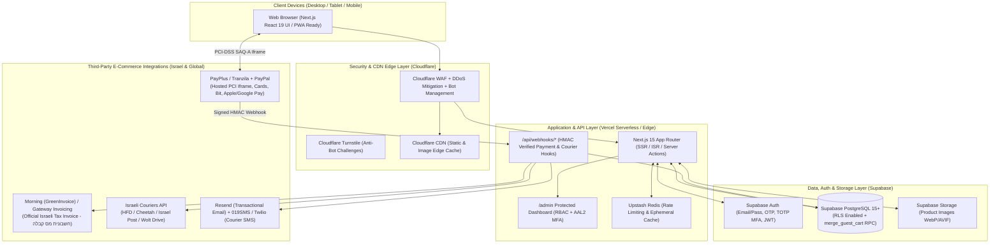

# Deliverable G: Technical Architecture & Platform Comparison

## 1. E-Commerce Platform Comparison Matrix

Before selecting the final stack, we evaluate the three primary architectural paths required in Section 10:
1. **Option 1: Custom E-Commerce Application (Next.js 15 App Router + Supabase PostgreSQL)** *(Recommended)*
2. **Option 2: Shopify (Standard / Plus)** *(The platform Mighty Depot runs on)*
3. **Option 3: WooCommerce (WordPress + Managed PHP Hosting)**

| Evaluation Criterion | Option 1: Custom Next.js + Supabase *(Recommended)* | Option 2: Shopify | Option 3: WooCommerce |
| :--- | :--- | :--- | :--- |
| **Mandatory Custom Auth & Cart Merge Logic** | **Native & Exact:** Full control over Step 1 mandatory registration/sign-in gate + atomic PostgreSQL `merge_guest_cart` RPC and Supabase RLS. | **Restricted on Standard Plans:** Customizing the checkout flow (forcing custom Step 1 auth UI inside checkout) requires **Shopify Plus ($2,300+/mo)** Checkout Extensibility. | **Possible via Plugins/Hooks:** Achievable in PHP, but prone to session/caching conflicts with WP caching plugins. |
| **Database Control (Supabase Requirement)** | **100% Native Supabase:** Directly uses the Supabase PostgreSQL schema, Storage, Auth, and RLS specified in Section 3 & Deliverable F. | **Proprietary SaaS DB:** Uses Shopify's closed multi-tenant database (requires external sync webhooks if Supabase is also used). | **MySQL Legacy Schema:** Stores products in `wp_posts` / `wp_postmeta` EAV tables, which degrades at scale. |
| **Israeli Localization (RTL, VAT, Price per 100g, Bit, Invoices)** | **First-Class Native Support:** Built-in bidirectional `LTR/RTL`, statutory `₪ / 100g` unit pricing, direct PayPlus/Tranzila iframe + Bit + automated `חשבונית מס קבלה`. | **Third-Party Apps Required:** Requires paid local connector apps for PayPlus/Tranzila, Israeli invoicing, and custom Liquid code for price-per-100g rules. | **Plugin-Heavy:** Relies on 10–15 third-party WordPress plugins, creating high maintenance and security risk. |
| **Performance & Core Web Vitals** | **Exceptional (`< 1.0s` LCP):** Next.js React Server Components (RSC), ISR edge caching, zero unused app-script bloat. | **Good to Moderate:** Fast CDN, but third-party Shopify apps inject heavy client-side JS bundles that slow down mobile LCP/INP. | **Poor to Moderate:** Heavy PHP/MySQL execution per uncached cart/checkout request. |
| **Cybersecurity Posture** | **Enterprise Zero-Trust:** Immutable serverless functions, PostgreSQL RLS, zero plugin vulnerabilities, Cloudflare WAF + Turnstile. | **High (Managed SaaS):** PCI Level 1 managed by Shopify, though third-party app OAuth scopes pose supply-chain risks. | **High Risk:** WordPress/WooCommerce plugins are the #1 target of automated web exploits globally. |
| **Transaction Fees (Platform Surcharge)** | **0% Platform Fee** (Pay only the Israeli payment gateway clearing rate ~1.2%–1.8%). | **0.5% to 2.0% Extra Shopify Fee** on every order when using external Israeli gateways (PayPlus/Tranzila) instead of Shopify Payments (which is unavailable in Israel). | **0% Platform Fee** (Gateway clearing rate only). |
| **Estimated Ongoing Monthly Cost** | **$65 – $140 / month** | **$150 – $450 / month** (+ 1%–2% third-party gateway penalty on gross revenue) | **$100 – $280 / month** (Managed WP hosting + paid annual plugin licenses) |

> [!TIP]
> **Architectural Recommendation:** Because your requirements explicitly specify a **Supabase database** (Section 3), a **custom mandatory Sign-In/Registration Checkout Gate with deterministic persistent cart merging** (Section 4), a **custom 15-module Administration Dashboard** (Section 8), and **Israeli payment gateways (`Bit`, `Isracard`, `Tashlumim`) without paying Shopify's 1%–2% third-party gateway penalty** (Section 6), **Option 1 (Next.js App Router + Supabase + Cloudflare + PayPlus)** is the clear architectural winner.

---

## 2. Recommended End-to-End System Architecture

---

## 3. Component-by-Component Technology Stack Specification

| Architectural Layer | Recommended Technology | Justification |
| :--- | :--- | :--- |
| **Frontend Framework** | **Next.js 15 (App Router) + TypeScript + Tailwind CSS + Radix UI / Shadcn UI** | Provides server-rendered SEO performance for all 8 categories, 41 subcategories, and thousands of product pages via Incremental Static Regeneration (ISR), instantaneous client transitions, and accessible WAI-ARIA primitives for dropdowns and drawers. |
| **Backend & API Layer** | **Next.js Route Handlers & Server Actions + Zod Validation** | Co-located, strictly typed backend logic running on isolated serverless/edge compute with zero cold-start overhead and end-to-end TypeScript safety. |
| **Database & Search** | **Supabase (PostgreSQL 15+)** with `pg_trgm` & Full-Text Search | ACID compliance for inventory reservations and cart merging, native Row-Level Security (RLS), and fast trigram/faceted search without needing an expensive external Algolia subscription at launch. |
| **Authentication** | **Supabase Auth (`@supabase/ssr`)** | Built-in Email/Password hashing, 6-digit OTP email verification, password reset flows, `HttpOnly` cookie session management, and native TOTP Multi-Factor Authentication (`aal2`) for admins. |
| **File & Image Storage** | **Supabase Storage + Next/Image CDN Optimization** | Stores original high-res product images in private/public buckets with automatic on-the-fly resizing and WebP/AVIF transformation. |
| **Rate Limiting & Cache** | **Upstash Serverless Redis** | Sub-millisecond sliding-window rate limiting on login, password reset, coupon checks, and checkout initiation. |
| **Hosting & Edge Security** | **Vercel Pro + Cloudflare Pro (WAF, DDoS, Turnstile)** | Global edge network with Tel Aviv (`TLV`) and Frankfurt (`FRA`) PoPs for `< 30ms` latency to Israeli shoppers, protected by OWASP WAF rules and free Turnstile bot protection. |
| **Payment Integration** | **PayPlus (`פייפלוס`)** (or **Tranzila / Grow**) + **PayPal** | PCI-DSS Level 1 Israeli gateway supporting Visa, Mastercard, Amex, Diners, Isracard, **Bit**, **Apple Pay**, **Google Pay**, and **Tashlumim** (installments), plus PayPal for international wallets. |
| **Tax Invoicing (Israel)** | **PayPlus Built-in Invoicing** or **Morning (`חשבונית ירוקה`) API** | Automatically generates and emails a legally signed Israeli Tax Invoice / Receipt (`חשבונית מס קבלה`) upon payment capture and Credit Invoice (`חשבונית זיכוי`) upon refund. |
| **Delivery & Courier Integration** | **HFD (`אייץ'.אף.די`) / Cheetah (`צ'יטה`) REST API** + **Boxit Lockers** | Automates waybill/label printing from `/admin/orders`, syncs live delivery status webhooks, and provides nationwide home courier and pickup locker coverage across Israel. |
| **Transactional Email & SMS** | **Resend (`React Email`)** + **019 Mobile / Inforu SMS API** | Delivers branded HTML order confirmation emails, password resets, and Israeli local SMS dispatch notifications (`05x` numbers). |
| **Observability & Error Tracking** | **Sentry** (PII-scrubbed) + **Vercel Analytics** | Real-time exception alerting, webhook failure monitoring, and Core Web Vitals tracking. |

---

## 4. Estimated Ongoing Operational Costs (TCO Breakdown)

| Service / Infrastructure Component | Tier / Plan | Monthly Cost (USD / ILS Equiv.) | Notes |
| :--- | :--- | :--- | :--- |
| **Domain Name (`.co.il` or `.com`)** | Annual Registration | ~$2 / mo (`₪85 / yr`) | Registered via ISOC-IL accredited registrar or Cloudflare Registrar. |
| **Cloudflare (WAF, DDoS, CDN, Turnstile)** | Pro Plan | $25 / mo (`~₪92`) | Includes OWASP WAF, DDoS mitigation, and unlimited Turnstile challenges. |
| **Vercel (Frontend & Serverless Compute)** | Pro Plan | $20 / mo (`~₪74`) | High-performance SSR/ISR hosting with Tel Aviv edge routing. |
| **Supabase (PostgreSQL DB, Auth, Storage)** | Pro Plan | $25 / mo (`~₪92`) | 8 GB database, 100 GB storage, automated daily backups, unlimited Auth MAUs up to 100k. |
| **Upstash Redis (Rate Limiting)** | Pay-as-you-go / Free | $0 – $10 / mo (`~₪0–₪37`) | Free up to 10,000 requests/day. |
| **Resend (Transactional Emails)** | Free / Pro | $0 – $20 / mo (`~₪0–₪74`) | Free up to 3,000 emails/month; $20/mo for 50,000 emails. |
| **PayPlus / Tranzila + Morning Invoicing** | Merchant Account | ~$18 / mo (`~₪65/mo`) + ~1.3%–1.8% clearing | Standard Israeli credit card & Bit clearing fee per captured transaction; **0% platform surcharge**. |
| **Total Fixed Monthly Infrastructure Cost** | — | **~$90 – $120 / month (`~₪330 – ₪440 / mo`)** | Scales smoothly to 50,000+ monthly visitors without architectural changes. |

