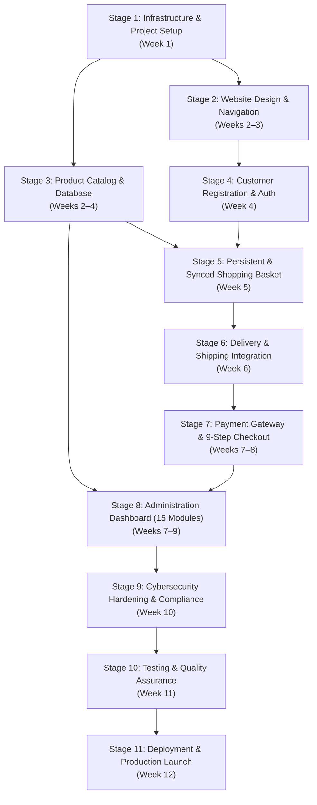

# Deliverable H: Phased Development Roadmap

## 1. Roadmap Overview & Execution Timeline

The development of the e-commerce platform is structured into **11 practical engineering stages**, progressing logically from core infrastructure and database setup through storefront UX, persistent basket synchronization, Israeli delivery/payment integrations, administration tooling, security hardening, and production launch.

---

## 2. Detailed Breakdown of the 11 Development Stages

### Stage 1: Infrastructure and Project Setup
- **Scope & Key Deliverables:**
  - Initialize monorepo/project with **Next.js 15 (App Router, TypeScript, Tailwind CSS)** and ESLint/Prettier strict rules.
  - Provision **Supabase** project (PostgreSQL 15+, Auth, Storage buckets) and apply initial migrations from [Deliverable_F_Database_Specification.md](file:///c:/Users/User/OneDrive/Documents/AI/Claude/Websites/Dino-Market/Scraped%20Information/Deliverable_F_Database_Specification.md).
  - Set up CI/CD pipeline (`GitHub Actions`) running TypeScript typechecks, unit tests, `npm audit`, and `gitleaks` secret scanning on every PR.
  - Provision staging and production environments on **Vercel** behind **Cloudflare DNS/SSL**.
- **Estimated Complexity:** **Low** (1 Week / ~30–40 engineering hours).
- **Dependencies:** None (Foundational stage).
- **Potential Costs:** Domain registration (`~$15–$25/yr`), Supabase Pro (`$25/mo`), Vercel Pro (`$20/mo`).

---

### Stage 2: Website Design and Navigation (Excluding Mighty Rewards)
- **Scope & Key Deliverables:**
  - Establish independent brand design system (color tokens, typography scales, RTL/LTR layout tokens, button/badge primitives).
  - Build the 3-Tier Global Header (Promotional Announcement Bar, Sticky Search/Utility Bar, and Desktop Horizontal Department Bar).
  - Implement all **8 Main Categories and 41 Subcategories** (`Shop by Region` 3-column mega-menu + 7 departmental dropdowns) with hover-intent (`120ms` open / `200ms` close grace period), keyboard WAI-ARIA navigation, and mobile slide-out accordion drawer per [Deliverable_C_Navigation_Specification.md](file:///c:/Users/User/OneDrive/Documents/AI/Claude/Websites/Dino-Market/Scraped%20Information/Deliverable_C_Navigation_Specification.md).
  - Explicitly exclude all Mighty Rewards menus, links, and widgets.
  - Build the 4-column responsive Footer and Homepage layout sections.
- **Estimated Complexity:** **Medium** (1.5–2 Weeks / ~60–75 engineering hours).
- **Dependencies:** Stage 1.
- **Potential Costs:** Optional custom brand illustration/icon pack (`$0–$200` one-time).

---

### Stage 3: Product Catalog, Search & Product Detail Pages
- **Scope & Key Deliverables:**
  - Seed categories, 13 regions, and initial product/variant catalog in Supabase.
  - Build Category (`/[category]`), Subcategory (`/[category]/[subcategory]`), and Regional (`/collections/region-[slug]`) listing pages with multi-facet filtering (Region, Subcategory, Price, Brand, Dietary/Kosher tags, In-Stock toggle) and 7 sorting modes.
  - Build Predictive Search bar popover (`/api/search/predictive`) and `/search` full results page using PostgreSQL `pg_trgm` + Full-Text Search.
  - Build the Product Detail Page (`/products/[slug]`) with interactive zoom gallery, variant selector, stock availability indicator, statutory unit price (`per 100g/100ml`), nutritional/allergen tabs, related products carousel, and verified customer reviews component.
- **Estimated Complexity:** **Medium–High** (2 Weeks / ~80–100 engineering hours).
- **Dependencies:** Stage 1, Stage 2.
- **Potential Costs:** Included in Supabase Pro.

---

### Stage 4: Customer Registration, Authentication & Account Portal
- **Scope & Key Deliverables:**
  - Implement Registration (`/auth/register`), Sign-In (`/auth/login`), 6-digit OTP & magic-link Email Verification, Forgot/Reset Password flows, and Sign-Out via `@supabase/ssr` (`HttpOnly`, `Secure`, `SameSite=Lax` cookies).
  - Implement Argon2id / salted bcrypt hashing + HaveIBeenPwned breached-password check.
  - Build the protected Customer Account Portal (`/account/*`): Profile Management, Security/Password Settings, Saved Delivery Addresses CRUD (`/account/addresses`), Order History (`/account/orders`), and Live Order Tracking view (`/account/orders/[id]`).
- **Estimated Complexity:** **Medium** (1–1.5 Weeks / ~50–65 engineering hours).
- **Dependencies:** Stage 1, Stage 2.
- **Potential Costs:** Resend transactional email service (`$0–$20/mo`).

---

### Stage 5: Persistent & Synchronized Shopping Basket
- **Scope & Key Deliverables:**
  - Build the global Slide-Out Shopping Basket Drawer and full `/cart` page with optimistic quantity steppers (`+ / -`), item removal, subtotal calculation, coupon code validation, and dynamic Free-Delivery progress bar.
  - Implement dual-layer anonymous guest basket persistence (`cart_session_token` cookie + `carts` table row in Supabase).
  - Implement and test the atomic PostgreSQL **`merge_guest_cart` RPC** so signing in or registering seamlessly merges the guest basket with the customer's persistent account basket without losing any items.
- **Estimated Complexity:** **Medium–High** (1 Week / ~45–60 engineering hours).
- **Dependencies:** Stage 3, Stage 4.
- **Potential Costs:** None (uses Supabase PostgreSQL).

---

### Stage 6: Delivery and Shipping Integration (Israel Configuration)
- **Scope & Key Deliverables:**
  - Implement the configurable Israeli Delivery Zone engine (`IL-Z1` Gush Dan through `IL-Z5` Eilat/Remote) with city/postal lookup, weight surcharge brackets, and heat-sensitive summer packaging rules.
  - Build the dynamic shipping calculator for Standard Courier, Express Courier, and Locker/Pickup Point (`נקודת איסוף`), including configurable free-delivery thresholds.
  - Integrate courier API (**HFD** / **Cheetah Delivery**) for automated waybill generation, tracking link assignment, and dispatch/delivery status webhooks.
- **Estimated Complexity:** **Medium** (1 Week / ~45–55 engineering hours).
- **Dependencies:** Stage 5.
- **Potential Costs:** Courier per-shipment fees (passed to/subsidized by shipping charges); SMS notification gateway (`~$15–$30/mo` usage).

---

### Stage 7: Payment Integration & 9-Step Checkout System
- **Scope & Key Deliverables:**
  - Build the progressive **9-Step Checkout Flow**:
    1. Mandatory Sign-In / Registration Gate (auto-merges guest basket).
    2. Delivery Address selection/entry.
    3. Delivery Method selection.
    4. Server-side Delivery Cost calculation.
    5. Itemized Order Summary + 15-minute soft stock reservation.
    6. Payment Method selection (Visa, Mastercard, Amex, Isracard, **Bit**, **Apple Pay**, **Google Pay**, **PayPal**, and configurable **Tashlumim** installments).
    7. PCI-DSS SAQ-A Hosted Payment Iframe processing (3D Secure 2.0).
    8. Order Confirmation screen (`/checkout/confirmation/[order_number]`).
    9. Automated Order Confirmation Email + official **Israeli Tax Invoice (`חשבונית מס קבלה`)** PDF generation.
  - Implement idempotent payment initiation, declined transaction recovery UI, and HMAC-SHA256 verified payment webhooks.
- **Estimated Complexity:** **High** (2 Weeks / ~85–110 engineering hours).
- **Dependencies:** Stage 4, Stage 5, Stage 6.
- **Potential Costs:** Payment gateway monthly terminal fee (`~₪65/mo` / `$18/mo`) + clearing percentage (`~1.3%–1.8%`).

---

### Stage 8: Administration Dashboard (15 Core Capabilities)
- **Scope & Key Deliverables:**
  - Build the RBAC-protected `/admin` portal requiring `aal2` (TOTP 2FA).
  - Implement all **15 administrative modules**:
    1. Product CRUD + nutritional/allergen editor
    2. Category, Subcategory & Region hierarchy manager
    3. Multi-image drag-and-drop uploader (Supabase Storage)
    4. Pricing, Sale Price & Coupon Discounts manager
    5. Real-time Inventory & Batch/Expiry ledger
    6. Order Fulfillment queue & packing slip printer
    7. Delivery Status & tracking updater
    8. Customer Directory & privacy management
    9. RMA Return & Gateway Refund processor (+ Credit Tax Invoice `חשבונית זיכוי`)
    10. Payment Gateway & Installments configuration
    11. Shipping Zones, Rates & Free-Shipping threshold configuration
    12. Promotional Banner & Announcement Bar scheduler
    13. Static Pages & Policy CMS editor
    14. Sales, Region & Inventory Analytics Dashboard
    15. Staff Role Management & immutable `admin_audit_logs` viewer.
- **Estimated Complexity:** **High** (2–2.5 Weeks / ~95–120 engineering hours).
- **Dependencies:** Stage 3, Stage 6, Stage 7.
- **Potential Costs:** None (built within the Next.js + Supabase stack).

---

### Stage 9: Cybersecurity Hardening & Privacy Compliance
- **Scope & Key Deliverables:**
  - Configure **Cloudflare WAF** (OWASP Core Ruleset), L3/L4/L7 DDoS protection, and **Cloudflare Turnstile** bot protection on auth/checkout/contact forms.
  - Implement **Upstash Redis** sliding-window rate limiting across all sensitive APIs.
  - Apply strict HTTP Security Headers (`Content-Security-Policy`, `HSTS`, `X-Frame-Options: DENY`, `X-Content-Type-Options: nosniff`).
  - Finalize GDPR & Israeli Protection of Privacy Law (PPL) compliance: Cookie Consent Banner, unchecked-by-default marketing opt-in, Self-Service Data Export, and Account Deletion with 7-year tax invoice pseudonymization.
  - Verify automated daily database backups and PITR restoration procedure.
- **Estimated Complexity:** **Medium** (1 Week / ~40–50 engineering hours).
- **Dependencies:** Stages 1–8.
- **Potential Costs:** Cloudflare Pro (`$25/mo`), Upstash Redis (`$0–$10/mo`).

---

### Stage 10: Testing and Quality Assurance
- **Scope & Key Deliverables:**
  - **Unit & Integration Tests (Vitest):** Test pricing/discount calculation math, Israeli VAT breakdown, shipping zone rate resolution, and `merge_guest_cart` edge cases.
  - **End-to-End Automated Tests (Playwright):** Test full guest browse -> add to cart -> checkout auth gate -> cart merge -> address -> shipping -> sandbox payment -> confirmation email across Desktop Chrome/Safari and Mobile iOS/Android viewports.
  - **Security & Penetration Testing:** Run OWASP ZAP automated scan, verify RLS tenant isolation across different customer/staff JWTs, and test webhook replay/tampering rejection.
  - **Accessibility & Performance Audit:** Verify Lighthouse score `>= 90` and WCAG 2.2 AA / Israeli Standard IS 5568 keyboard/screen-reader compliance.
- **Estimated Complexity:** **Medium** (1 Week / ~45–60 engineering hours).
- **Dependencies:** Stage 9.
- **Potential Costs:** Optional external penetration test if required by enterprise stakeholders (`$0` internal suite / `$1,500+` external audit).

---

### Stage 11: Deployment and Production Launch
- **Scope & Key Deliverables:**
  - Migrate production catalog data, product photography, and verified bilingual legal policies (`Shipping`, `Refunds`, `Privacy`, `Terms`, `Accessibility`).
  - Switch payment gateway (`PayPlus`/`Tranzila` + `PayPal`) and courier integrations (`HFD`/`Cheetah`) from Sandbox to Live credentials and execute a real `₪5.00` live smoke-test purchase and refund.
  - Configure production DNS records, SSL/HSTS preload, Google Search Console (`sitemap.xml`, `robots.txt`, Product JSON-LD structured data), and uptime/error alerting (Sentry + BetterStack).
  - Go live and monitor launch metrics over a 72-hour hypercare window.
- **Estimated Complexity:** **Low–Medium** (3–5 Days / ~25–35 engineering hours).
- **Dependencies:** Stage 10.
- **Potential Costs:** Standard production monthly hosting & gateway fees (`~$90–$120/mo`).

---

## 3. Summary Resource & Effort Matrix

| Stage | Stage Name | Complexity | Est. Effort (Hours) | Target Schedule | Est. Incremental Monthly Cost |
| :---: | :--- | :---: | :---: | :---: | :--- |
| **1** | Infrastructure & Project Setup | Low | 30–40 hrs | Week 1 | ~$47 / mo |
| **2** | Website Design & Navigation | Medium | 60–75 hrs | Weeks 2–3 | $0 / mo |
| **3** | Product Catalog, Search & PDPs | Medium–High | 80–100 hrs | Weeks 2–4 | $0 / mo |
| **4** | Customer Registration & Auth | Medium | 50–65 hrs | Week 4 | ~$0–$20 / mo |
| **5** | Persistent & Synced Shopping Basket | Medium–High | 45–60 hrs | Week 5 | $0 / mo |
| **6** | Delivery & Shipping Integration (Israel) | Medium | 45–55 hrs | Week 6 | ~$15 / mo (SMS) |
| **7** | Payment Integration & 9-Step Checkout | High | 85–110 hrs | Weeks 7–8 | ~$18 / mo + clearing % |
| **8** | Administration Dashboard (15 Modules) | High | 95–120 hrs | Weeks 7–9 | $0 / mo |
| **9** | Cybersecurity Hardening & Compliance | Medium | 40–50 hrs | Week 10 | ~$25–$35 / mo |
| **10** | Testing & Quality Assurance | Medium | 45–60 hrs | Week 11 | $0 / mo |
| **11** | Deployment & Production Launch | Low–Medium | 25–35 hrs | Week 12 | $0 / mo |
| **Total** | **Complete Production E-Commerce Platform** | — | **600 – 770 hrs** | **~12 Weeks** | **~$90 – $120 / mo Fixed TCO** |

